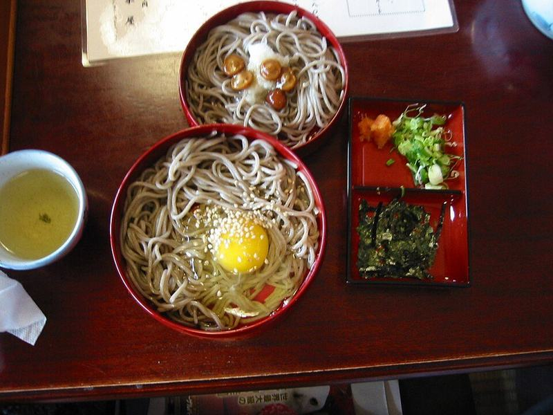

# Cold Sesame Soba Noodle Salad with Edamame

Photo: Jnn · CC BY-SA 3.0 · [source](https://commons.wikimedia.org/wiki/File:Izumosoba33.JPG)

**Lunch** · Japanese · 25 min · serves 4 · skill 1/3

> Nutty buckwheat noodles chilled and tossed with edamame, crunchy cabbage, cucumber and carrots in a creamy sesame-ginger dressing. Made to eat cold from a lunch container.

| Per serving | kcal | Protein | Carbs | Fat | Fiber | Sodium | Cost |
| --- | --- | --- | --- | --- | --- | --- | --- |
| | 530 | 23 g | 73 g | 18 g | 10 g | 1440 mg | $2.15 |

Contains: gluten, sesame

## Ingredients

- 9.5 oz soba noodles
- 12 oz shelled edamame, thawed
- 1 English cucumber, cut in matchsticks
- 2 carrots, shredded
- 3 cups coleslaw mix or shredded red cabbage
- 4 green onions, sliced
- 2 tbsp tahini
- 3 tbsp soy sauce
- 1 tbsp honey
- 1 tbsp grated ginger
- 2 tbsp toasted sesame seeds
- cilantro, chopped

From the pantry: 3 tbsp rice vinegar, 2 tbsp sesame oil, 1 tsp chili flakes, pinch of salt

## Steps

1. Cook the soba in plenty of boiling water until just tender, 4 to 5 minutes, adding the edamame for the last minute.
2. Drain and rinse under cold running water, rubbing the noodles with your hands, until cool and no longer starchy. Drain very well.
3. Whisk the tahini, soy sauce, vinegar, sesame oil, honey, ginger and chili flakes with 1 to 2 tbsp water until creamy.
4. Toss the noodles and edamame with the cucumber, carrots, cabbage, green onions and dressing.
5. Top with sesame seeds and cilantro and serve cold.

**Tip:** Rinse soba hard in cold water. The surface starch makes the noodles gummy and clumped by lunchtime if you skip it.

## Storing

Fridge 3 days · freezer not recommended. Eat cold. If the noodles soak up the dressing overnight, loosen them with a splash of soy sauce and rice vinegar.

