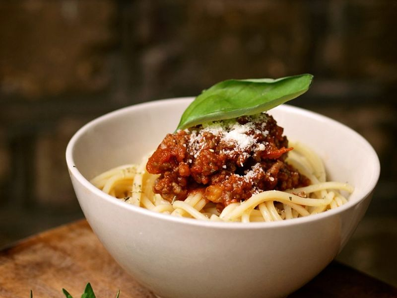

# Spaghetti Bolognese with Beef & Pork Ragù

Photo: hozinja · CC BY 2.0 · [source](https://commons.wikimedia.org/wiki/File:Spaghetti_bolognese_(hozinja).jpg)

**Dinner** · Italian · 70 min · serves 5 · skill 2/3

> A slow-bubbling meat sauce of beef and pork with soffritto, red wine and a splash of milk, tossed with spaghetti in the pan until every strand is coated.

| Per serving | kcal | Protein | Carbs | Fat | Fiber | Sodium | Cost |
| --- | --- | --- | --- | --- | --- | --- | --- |
| | 815 | 41 g | 84 g | 35 g | 7 g | 950 mg | $2.31 |

Contains: gluten, dairy, beef, pork

## Ingredients

- 1 lb ground beef
- ½ lb ground pork
- 1 small onion, finely chopped
- 1 carrot, finely chopped
- 1 celery stalk, finely chopped
- 2 garlic cloves, minced
- 28 oz crushed tomatoes
- 1 cup beef broth
- ½ cup milk
- 1 lb spaghetti or tagliatelle
- grated Parmesan, to serve

From the pantry: 1 tbsp olive oil, 2 tbsp tomato paste, ½ cup dry red wine, 2 tsp Worcestershire sauce, 2 bay leaves, ½ tsp dried thyme, 1 tsp sugar, salt, pepper

## Steps

1. Heat the oil in a large heavy pot over medium. Cook the onion, carrot and celery until soft and sweet, about 6 minutes, then add the garlic for 1 minute.
2. Turn the heat to high, add the beef and pork and cook, breaking it up, until no longer pink and starting to brown, 6 to 8 minutes. Pour in the milk and simmer until it disappears, then add the wine and cook 1 to 2 minutes, scraping the bottom.
3. Stir in the tomatoes, tomato paste, broth, Worcestershire, bay leaves, thyme, sugar, ¾ tsp salt and pepper. Simmer gently, uncovered, for 30 to 40 minutes, stirring now and then and adding a splash of water if it gets too thick.
4. Cook the pasta in well-salted boiling water 1 minute short of the package time. Save a mug of pasta water, then drain.
5. Add the pasta to the sauce with about ½ cup pasta water and toss over medium heat for 2 minutes until the sauce clings. Serve with Parmesan.

**Tip:** If you have time, add ¾ cup water, cover and simmer on very low for 2 hours; the sauce becomes silkier and deeper. It is also excellent made a day ahead.

Adapted from [RecipeTin Eats](https://www.recipetineats.com/spaghetti-bolognese/).

## Storing

Fridge 4 days · freezer up to 4 months. Freeze the sauce without pasta. Reheat on the stove and cook fresh pasta, or microwave leftovers with a splash of water.

