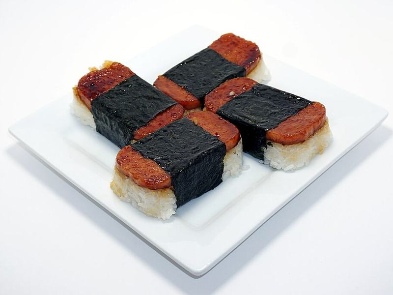

# Spam & Egg Musubi

Photo: Chris Hackmann · CC BY-SA 4.0 · [source](https://commons.wikimedia.org/wiki/File:Homemade_Spam_Musubi.jpg)

**Breakfast** · Hawaiian · 40 min · serves 4 · skill 2/3

> Hawaii's favorite grab-and-go: caramelized soy-glazed Spam and a thin egg omelet pressed onto blocks of seasoned sticky rice and wrapped in crisp nori.

| Per serving | kcal | Protein | Carbs | Fat | Fiber | Sodium | Cost |
| --- | --- | --- | --- | --- | --- | --- | --- |
| | 675 | 24 g | 72 g | 31 g | 1 g | 2150 mg | $1.67 |

Contains: pork, gluten, egg

## Ingredients

- 1 can (12 oz) Spam, cut into 8 slices
- 1½ cups short-grain or Calrose rice
- 4 eggs
- 4 sheets nori, halved
- ¼ cup soy sauce

From the pantry: 3 tbsp sugar, 2 tbsp mirin, 1 tbsp rice vinegar, 1 tsp oil, salt

## Steps

1. Rinse the rice until the water runs nearly clear and cook it with 1¾ cups water. Stir in the rice vinegar and a pinch of salt and keep covered.
2. Fry the Spam slices in a dry nonstick skillet over medium until browned, 2 to 3 minutes per side. Stir the soy sauce, sugar and mirin together, pour into the pan and simmer, turning the slices, until sticky and glazed, 1 to 2 minutes. Set aside and wipe the pan.
3. Beat the eggs with a pinch of salt. Heat the oil over medium-low, pour in the eggs and cook without stirring until set, 3 minutes. Flip, cook 30 seconds, then cut into 8 rectangles the size of the Spam.
4. Lay a half-sheet of nori shiny side down. Use a musubi mold or the cleaned Spam can, lined with plastic wrap: pack in ⅓ cup rice, then top with egg and Spam and press firmly.
5. Lift off the mold, wrap the nori snugly around the block and seal the end with a grain of rice. Repeat to make 8 and eat while warm.

**Tip:** Wet your hands and the mold before packing the rice, and press hard. Firmly packed rice is what keeps musubi from falling apart.

## Storing

Fridge 1 days · freezer not recommended. Wrap each in plastic and keep at room temperature up to 6 hours. Chilled rice turns hard; if you refrigerate, microwave 20 to 30 seconds.

