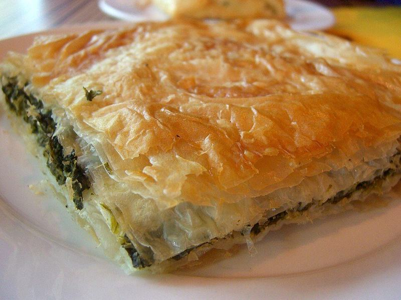

# Spanakopita (Crisp Spinach & Feta Pie) with Cucumber-Tomato Salad

Photo: Alpha · CC BY-SA 2.0 · [source](https://commons.wikimedia.org/wiki/File:Spanakopita.jpg)

**Dinner** · Greek · 75 min · serves 4 · skill 2/3

> Shattering, buttery phyllo wrapped around a lemony, herb-flecked spinach and feta filling, served with a crunchy cucumber and tomato salad.

| Per serving | kcal | Protein | Carbs | Fat | Fiber | Sodium | Cost |
| --- | --- | --- | --- | --- | --- | --- | --- |
| | 785 | 27 g | 48 g | 56 g | 7 g | 1850 mg | $4.67 |

Contains: gluten, dairy, egg

## Ingredients

- ½ lb phyllo dough (1 roll), thawed
- 20 oz baby spinach
- 12 oz feta crumbles (2 tubs)
- 3 eggs
- 1 bunch green onions, sliced
- ½ lemon, zested and juiced
- 8 tbsp (1 stick) butter, melted
- 1 English cucumber, chopped
- 1 pint grape tomatoes, halved

From the pantry: 2 tbsp olive oil, 2 tsp dried dill, 1 tsp dried oregano, ¼ tsp nutmeg, 1 tbsp red wine vinegar, ½ tsp salt, ½ tsp black pepper

## Steps

1. Heat the oven to 375°F. Wilt the spinach in batches in a large pot with 1 tbsp of the oil over medium, 2 to 3 minutes per batch. Cool, then squeeze it very dry in a towel and chop.
2. Mix the spinach with the feta, eggs, green onions, lemon zest, dill, nutmeg and pepper.
3. Brush a 9x13 dish with butter. Layer in half the phyllo sheets, brushing each with butter (cover the stack with a damp towel as you work). Spread in the filling, then layer the remaining sheets on top, buttering each one.
4. Tuck in the edges, butter the top and score it into 8 squares with a sharp knife. Bake until deep golden and crisp, 40 to 45 minutes.
5. While it bakes, toss the cucumber and tomatoes with the remaining oil, the vinegar, lemon juice, oregano and salt. Let the pie rest 10 minutes before cutting.

**Tip:** Squeeze the spinach until it is truly dry. Leftover water is what makes the bottom layer soggy.

## Storing

Fridge 3 days · freezer up to 2 months. Re-crisp squares uncovered at 350°F for 10 to 15 minutes. Avoid the microwave, which makes the phyllo chewy.

