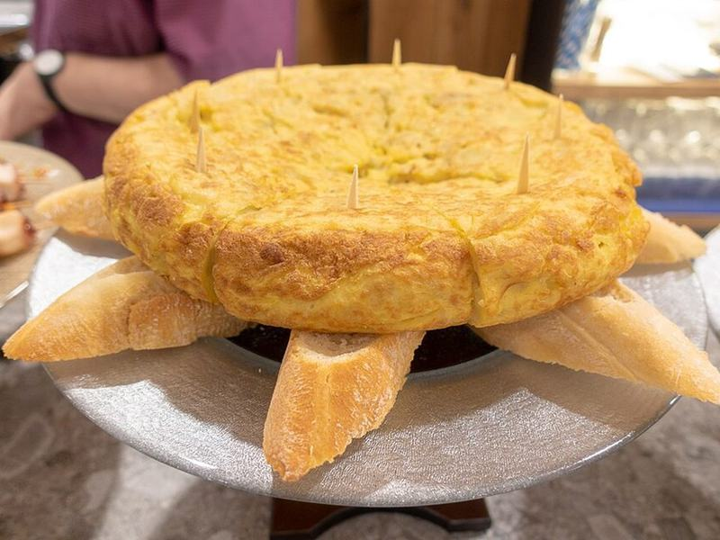

# Tortilla Española (Spanish Potato & Onion Omelet)

Photo: Kent Wang · CC BY-SA 2.0 · [source](https://commons.wikimedia.org/wiki/File:Tortilla_de_patata_-_San_Sebasti%C3%A1n.jpg)

**Breakfast** · French & Spanish · 50 min · serves 4 · skill 2/3

> Thin-sliced potatoes and sweet onion slowly poached in olive oil, then set in eggs into a thick, custardy golden cake. Served warm or at room temperature with crusty bread.

| Per serving | kcal | Protein | Carbs | Fat | Fiber | Sodium | Cost |
| --- | --- | --- | --- | --- | --- | --- | --- |
| | 555 | 17 g | 56 g | 31 g | 6 g | 630 mg | $0.93 |

Contains: egg, gluten

## Ingredients

- 1½ lb russet potatoes, peeled and thinly sliced
- 1 large onion, thinly sliced
- 6 eggs
- ½ baguette, sliced

From the pantry: ¾ cup olive oil, 1¼ tsp salt

## Steps

1. Heat the olive oil in a 10-inch nonstick skillet over medium. Add the potatoes, onion and 1 tsp salt and cook gently, turning now and then, until the potatoes are completely tender but barely browned, 18 to 20 minutes. Lower the heat if they start to fry hard.
2. Drain the potatoes in a colander set over a bowl to save the oil. Beat the eggs with ¼ tsp salt in a large bowl, fold in the warm potatoes and let soak 10 minutes.
3. Wipe the skillet, add 2 tbsp of the saved oil and heat over medium. Pour in the egg mixture, spread it level and cook, shaking the pan and running a spatula around the edge, until the bottom is golden and the sides are set, 5 to 6 minutes.
4. Cover the pan with a large plate, flip the tortilla onto it in one quick move, then slide it back into the pan wet side down. Cook 3 to 4 minutes more, until just set in the middle.
5. Slide onto a board, rest 5 minutes and cut into wedges. Serve with the bread.

**Tip:** Save the strained potato oil. It's full of flavor and great for frying eggs or roasting vegetables later in the week.

## Storing

Fridge 3 days · freezer not recommended. Keeps well and is classic at room temperature. Bring cold slices out 20 minutes before eating, or warm in a 300°F oven for 10 minutes.

