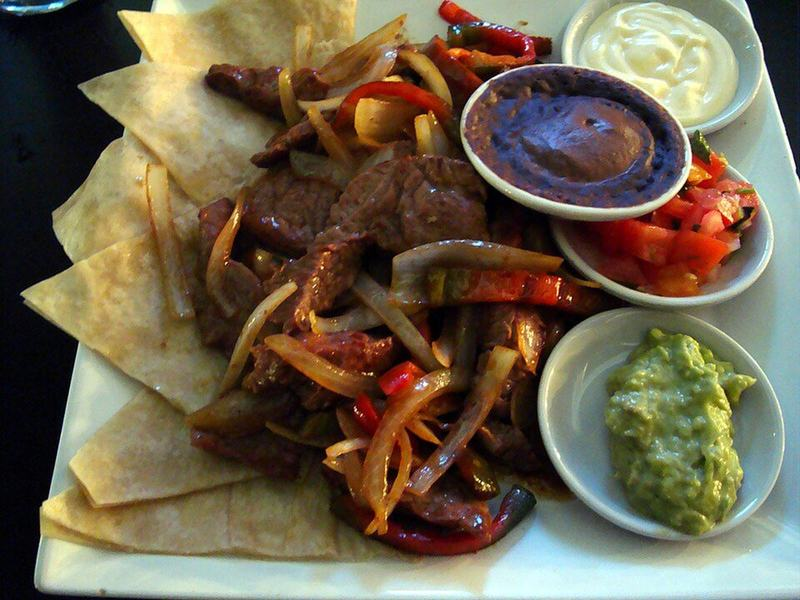

# Sheet-Pan Steak Fajitas

Photo: Eric T Gunther · CC BY-SA 3.0 · [source](https://commons.wikimedia.org/wiki/File:Beef_Fajitas_Costa_Rica.JPG)

**Dinner** · Mexican & Tex-Mex · 30 min · serves 4 · skill 1/3

> Sizzling strips of sirloin with rainbow peppers and onions, roasted hot on one pan and piled into warm tortillas with the works.

| Per serving | kcal | Protein | Carbs | Fat | Fiber | Sodium | Cost |
| --- | --- | --- | --- | --- | --- | --- | --- |
| | 970 | 53 g | 87 g | 48 g | 13 g | 2180 mg | $5.40 |

Contains: beef, dairy, gluten

## Ingredients

- 1½ lb top sirloin, sliced thin across the grain
- 3 bell peppers, sliced
- 1 large onion, sliced
- 1 packet taco seasoning
- 2 limes
- 10 flour tortillas
- ½ cup sour cream
- 2 avocados, sliced
- cilantro, chopped

From the pantry: 3 tbsp oil, salt

## Steps

1. Heat the oven to 450°F with a sheet pan inside.
2. Toss the peppers and onion with 2 tbsp oil and half the seasoning. Spread on the hot pan and roast 12 minutes.
3. Toss the steak with the rest of the oil and seasoning and the juice of 1 lime.
4. Push the vegetables to the edges, add the steak in one layer and broil 4 to 5 minutes, until the steak is browned outside and still pink in the middle.
5. Squeeze over the second lime and serve with warm tortillas, sour cream, avocado and cilantro.

**Tip:** Slice the steak while it's half-frozen and you'll get thin, even strips.

## Storing

Fridge 3 days · freezer up to 3 months. Store meat and vegetables together, toppings separately. Reheat in a skillet over medium with a splash of water until hot, 3 to 5 minutes.

## Other ways to make it

- Chicken
- Shrimp
- Pork
- Tofu
