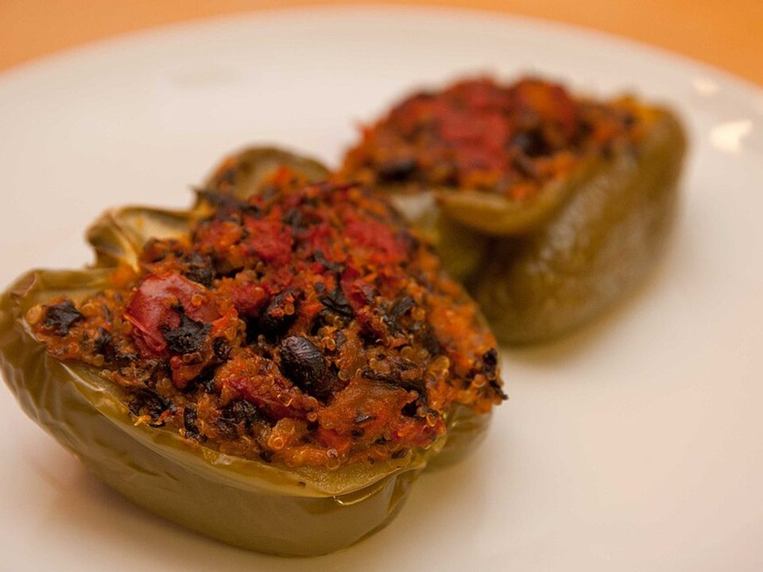

# Cheesy Beef & Rice Stuffed Peppers

Photo: Mark Bonica · CC BY 2.0 · [source](https://commons.wikimedia.org/wiki/File:Quinoa_stuffed_peppers.jpg)

**Dinner** · American comfort · 55 min · serves 4 · skill 1/3

> Sweet bell peppers stuffed with seasoned beef, rice and tomatoes, baked until tender and topped with a molten layer of cheese.

| Per serving | kcal | Protein | Carbs | Fat | Fiber | Sodium | Cost |
| --- | --- | --- | --- | --- | --- | --- | --- |
| | 755 | 39 g | 49 g | 46 g | 7 g | 1810 mg | $3.45 |

Contains: beef, dairy

## Ingredients

- 4 large bell peppers
- 1 lb ground beef
- 1 onion, diced
- 3 garlic cloves
- ¾ cup rice (or 2 cups cooked)
- 1 can diced tomatoes
- 1 packet taco or Italian seasoning
- 2 cups shredded cheese
- parsley or cilantro

From the pantry: 1 tbsp oil, salt

## Steps

1. Cook the rice. Heat the oven to 375°F. Halve the peppers through the stem and scoop out the seeds.
2. Brown the beef with the onion. Add the garlic and seasoning, then the tomatoes, and simmer 5 minutes.
3. Stir in the rice and 1 cup cheese.
4. Pack the filling into the pepper halves in a baking dish. Add ¼ cup water to the dish and cover with foil.
5. Bake 30 minutes, uncover, top with the remaining cheese and bake 10 minutes until melted and the peppers are tender.

**Tip:** Swap the rice for cauliflower rice to make these low-carb.

## Storing

Fridge 4 days · freezer up to 3 months. Reheat covered at 350°F for 15 to 20 minutes (or microwave single portions 2 minutes).

## Other ways to make it

- Ground turkey
- Ground pork
- Italian sausage
- Lentils (veg)
