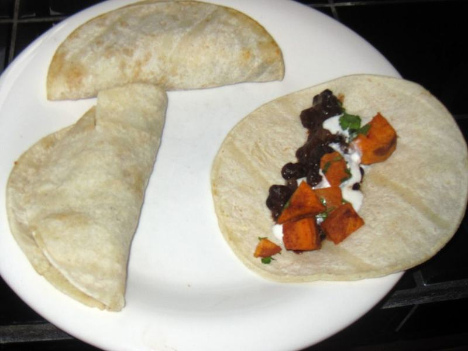

# Crispy Sweet Potato & Black Bean Tacos

Photo: Karen and Brad Emerson · CC BY 2.0 · [source](https://commons.wikimedia.org/wiki/File:Roasted_sweet_potato_%2B_black_bean_tacos_(7784822910).jpg)

**Dinner** · Mexican & Tex-Mex · 35 min · serves 4 · skill 1/3

> Roasted, smoky sweet potato and black beans in charred corn tortillas, topped with lime slaw, feta and a quick chipotle-style crema.

| Per serving | kcal | Protein | Carbs | Fat | Fiber | Sodium | Cost |
| --- | --- | --- | --- | --- | --- | --- | --- |
| | 700 | 18 g | 89 g | 34 g | 21 g | 1790 mg | $1.95 |

Contains: dairy

## Ingredients

- 2 medium sweet potatoes (about 1½ lb), cut in ½-inch cubes
- 1 can black beans, drained and rinsed
- 1 packet taco seasoning
- 8 corn tortillas
- 3 cups coleslaw mix
- 2 limes
- ½ cup sour cream
- ½ cup feta crumbles
- 2 avocados, sliced
- a handful of cilantro

From the pantry: 3 tbsp olive oil, salt, hot sauce

## Steps

1. Heat the oven to 425°F. Toss the sweet potatoes with 2 tbsp oil and half the taco seasoning and roast 20 minutes.
2. Add the black beans and the rest of the seasoning to the pan, toss and roast 8 minutes more, until the potatoes are crisp-edged.
3. Toss the slaw with the juice of 1 lime, 1 tbsp oil and a pinch of salt.
4. Stir the sour cream with a squeeze of lime and a few dashes of hot sauce.
5. Char the tortillas over a gas flame or in a dry skillet. Fill with the sweet potato and beans, then slaw, avocado, feta, crema and cilantro.

**Tip:** Double up the tortillas if they're thin so the tacos hold together.

## Storing

Fridge 4 days · freezer not recommended. Store the filling, slaw and crema separately and build tacos fresh. Reheat the filling in a skillet.

