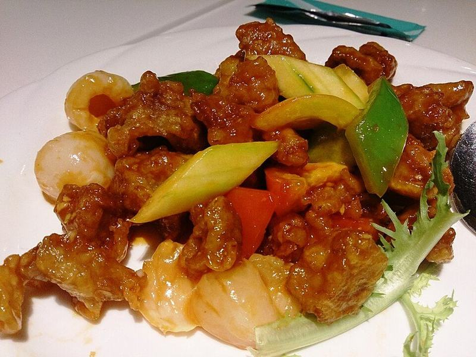

# Sweet & Sour Pork with Pineapple

Photo: ProjectManhattan · CC BY-SA 3.0 · [source](https://commons.wikimedia.org/wiki/File:Sweet_and_sour_pork.jpg)

**Dinner** · Chinese & Cantonese · 40 min · serves 4 · skill 2/3

> Crisp golden pork bites, juicy pineapple and peppers in a bright, tangy sauce that's nothing like the gloopy red stuff. Serve it over steamed rice.

| Per serving | kcal | Protein | Carbs | Fat | Fiber | Sodium | Cost |
| --- | --- | --- | --- | --- | --- | --- | --- |
| | 800 | 39 g | 110 g | 23 g | 5 g | 840 mg | $2.59 |

Contains: gluten, egg

## Ingredients

- 1¼ lb pork tenderloin, in 1-inch cubes
- 1 egg
- 2 cups fresh pineapple chunks
- 2 bell peppers (1 red, 1 green), in 1-inch squares
- 1 onion, in 1-inch pieces
- 3 garlic cloves, minced
- 1 tbsp soy sauce
- 1½ cups jasmine rice

From the pantry: ½ cup cornstarch, ⅓ cup oil, ⅓ cup ketchup, ¼ cup rice vinegar, 3 tbsp sugar, salt

## Steps

1. Start the rice. Whisk the ketchup, vinegar, sugar, soy sauce, 1 tsp cornstarch and ⅓ cup pineapple juice or water for the sauce.
2. Toss the pork with the egg and ½ tsp salt, then with the remaining cornstarch until each piece is fully coated.
3. Heat the oil in a large skillet over medium-high until a pinch of cornstarch sizzles. Fry the pork in two batches, turning, until deep golden and 145°F inside, 5 to 6 minutes per batch. Drain on a rack.
4. Pour off all but 1 tbsp oil. Stir-fry the onion and peppers over high heat 2 minutes, then add the pineapple and garlic and cook 1 minute more, until the pineapple caramelizes at the edges.
5. Pour in the sauce and simmer until thick and shiny, about 1 minute. Add the pork, toss quickly to coat and serve at once over rice.

**Tip:** Toss the pork in the sauce at the last second. The coating stays crisp for a few minutes, so get it to the table.

## Storing

Fridge 3 days · freezer not recommended. Reheat the pork on a rack in a 400°F oven or air fryer for 6 to 8 minutes, then warm the sauce and vegetables separately.

## Other ways to make it

- Chicken
- Steak
- Shrimp
- Tofu
