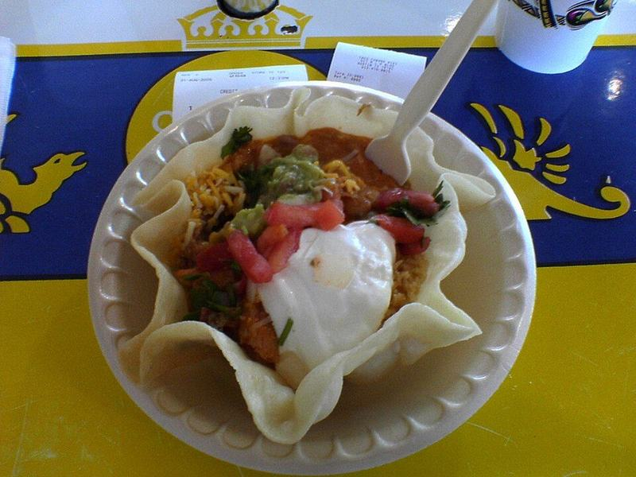

# Ground Turkey Taco Salad with Salsa Ranch

Photo: Jeff Kramer from Austin, Texas, United States · CC BY 2.0 · [source](https://commons.wikimedia.org/wiki/File:Flickr_jeffk_38941161--Taco_salad.jpg)

**Lunch** · Tex-Mex · 25 min · serves 4 · skill 1/3

> Crunchy romaine piled with taco-spiced turkey, black beans, cheese, avocado and crushed tortilla chips, tossed in a creamy salsa dressing.

| Per serving | kcal | Protein | Carbs | Fat | Fiber | Sodium | Cost |
| --- | --- | --- | --- | --- | --- | --- | --- |
| | 800 | 41 g | 60 g | 46 g | 17 g | 3080 mg | $3.40 |

Contains: dairy

## Ingredients

- 1 lb ground turkey
- 1 packet taco seasoning
- 2 romaine hearts, chopped
- 1 can black beans, rinsed
- 1 cup grape tomatoes, halved
- 1 cup shredded Mexican cheese
- 2 avocados, diced
- 4 oz tortilla chips
- 1 cup chunky salsa, divided
- ½ cup sour cream
- 4 green onions, sliced
- 1 lime

From the pantry: 1 tbsp oil, salt

## Steps

1. Heat the oil in a skillet over medium-high. Add the turkey and cook, breaking it up, until browned with no pink left, 6 to 7 minutes.
2. Stir in the taco seasoning, the black beans and ⅓ cup water and simmer until saucy and thick, 2 to 3 minutes. Let cool a few minutes.
3. Whisk the sour cream with ½ cup of the salsa and a squeeze of lime to make the dressing.
4. Toss the romaine with the tomatoes, green onions and half the dressing.
5. Top with the warm turkey and beans, cheese, avocado and lightly crushed chips. Spoon over the rest of the dressing and salsa and serve.

**Tip:** For packed lunches, keep the turkey, the dressing and the chips in separate containers and combine at lunchtime so the chips stay crunchy.

## Storing

Fridge 3 days · freezer up to 3 months. Store turkey, salad and chips separately. Microwave the turkey for 1 minute before topping; it freezes well on its own.

## Other ways to make it

- Ground beef
- Ground pork
- Italian sausage
- Lentils (veg)
