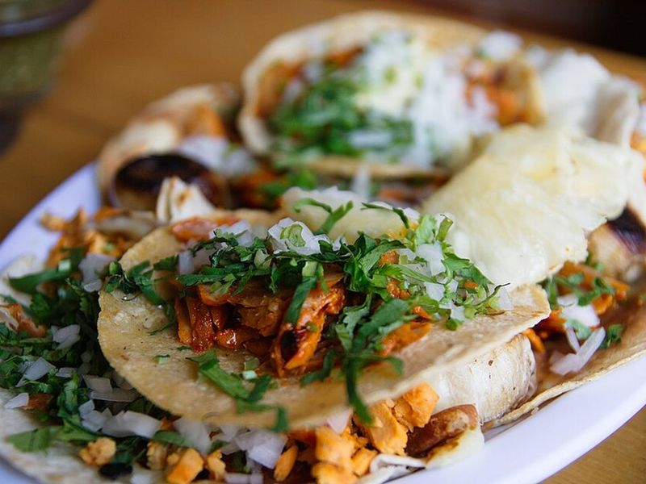

# Skillet Tacos al Pastor with Charred Pineapple

Photo: William Neuheisel · CC BY 2.0 · [source](https://commons.wikimedia.org/wiki/File:01_Tacos_al_Pastor.jpg)

**Dinner** · Mexican · 60 min · serves 6 · skill 2/3

> Mexico City's favorite taco without the spit: thin pork shoulder slices marinated in a guajillo-achiote adobo, seared crisp in a hot skillet and tucked into tortillas with charred pineapple, onion and cilantro.

| Per serving | kcal | Protein | Carbs | Fat | Fiber | Sodium | Cost |
| --- | --- | --- | --- | --- | --- | --- | --- |
| | 775 | 43 g | 42 g | 48 g | 7 g | 750 mg | $2.75 |

Contains: pork

## Ingredients

- 3 lb boneless pork shoulder, sliced ¼ inch thick
- 3 dried guajillo chiles, stemmed and seeded
- 2 tbsp achiote paste
- 3 garlic cloves
- 1 large white onion (half for the marinade, half chopped to serve)
- 1 orange, juiced
- 3 limes (1 juiced, 2 in wedges)
- ½ pineapple, peeled and cut in ½-inch slices
- 18 corn tortillas
- 1 bunch cilantro, chopped
- 1 cup salsa verde

From the pantry: ⅓ cup white vinegar, 2 tbsp oil, 1 tsp ground cumin, ½ tsp cinnamon, ½ tsp allspice, 1 tsp dried oregano, 1 tsp brown sugar, 1 tsp black pepper, 2 tsp salt

## Steps

1. Toast the guajillos in a dry skillet over medium for 1 minute per side. Simmer them in water until soft, about 12 minutes, then drain.
2. Blend the chiles with the garlic, half the onion, the achiote, orange juice, juice of 1 lime, vinegar, cumin, cinnamon, allspice, oregano, brown sugar, pepper and salt until smooth. Set aside ¼ cup, and toss the pork with the rest. Marinate at least 3 hours or overnight.
3. Heat a large cast-iron skillet over medium-high with a little oil. Brush the pineapple with the reserved marinade and sear until charred, 2 to 3 minutes per side, then chop.
4. Sear the pork in batches in a single layer with a little more oil until charred at the edges and cooked through, 3 to 4 minutes per side. Rest a few minutes, then chop into small pieces on the board.
5. Warm the tortillas. Serve the pork in doubled-up tortillas with the pineapple, chopped onion, cilantro, lime wedges and salsa verde.

**Tip:** Freeze the pork for 30 to 40 minutes before slicing; firm meat is much easier to cut thin. Leftover pork with melted cheese in a flour tortilla is a gringa.

Adapted from [Pati Jinich (SBS Food)](https://www.sbs.com.au/food/recipes/patis-tacos-al-pastor).

## Storing

Fridge 3 days · freezer up to 3 months. Store pork and toppings separately. Re-crisp the pork in a hot skillet for 2 to 3 minutes.

