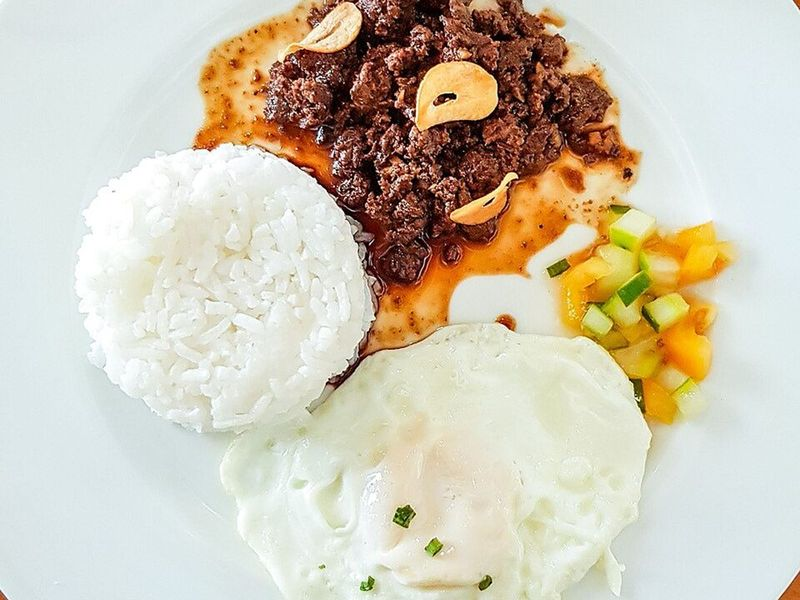

# Tapsilog: Sweet Garlic Beef Tapa, Garlic Rice & Fried Egg

Photo: Efrenefren · CC BY-SA 4.0 · [source](https://commons.wikimedia.org/wiki/File:Beef_tapa_with_steamed_rice_and_sliced_tomato_and_cucumber.jpg)

**Breakfast** · Filipino · 70 min · serves 4 · skill 2/3

> The king of Filipino breakfasts: thin, caramelized sweet-salty beef, garlicky fried rice (sinangag) and a sunny egg, with spiced vinegar for dipping.

| Per serving | kcal | Protein | Carbs | Fat | Fiber | Sodium | Cost |
| --- | --- | --- | --- | --- | --- | --- | --- |
| | 610 | 38 g | 60 g | 24 g | 1 g | 890 mg | $2.82 |

Contains: gluten, egg, beef

## Ingredients

- 1 lb top sirloin, sliced paper-thin against the grain
- 3 tbsp soy sauce
- 10 garlic cloves, minced
- 4 eggs
- 1¼ cups jasmine rice, cooked the day before (about 4 cups cooked)

From the pantry: 3 tbsp brown sugar, 3 tbsp oil, ¼ cup white or cane vinegar, ½ tsp black pepper, salt

## Steps

1. Mix the soy sauce, brown sugar, 1 tbsp vinegar, the pepper and half the garlic. Massage it into the beef and marinate at least 30 minutes, or overnight in the fridge.
2. For the dipping sauce, stir the rest of the vinegar with a pinch of salt and pepper and a little of the minced garlic.
3. For the sinangag, heat 1½ tbsp oil in a large skillet over medium and fry the remaining garlic until light golden, about 1 minute. Add the cold rice, break up any clumps, season with ½ tsp salt and stir-fry until hot and lightly toasted, 4 to 5 minutes. Keep warm.
4. Put the beef and its marinade in a wide pan with ½ cup water over medium-high. Simmer until the liquid is nearly gone, 6 to 8 minutes, then add 1 tbsp oil and fry, turning, until the edges caramelize and darken, 2 to 3 minutes.
5. Fry the eggs in the remaining oil until the whites are set and the edges lacy. Plate each serving with rice, beef and an egg, with the vinegar on the side.

**Tip:** Freeze the steak for 20 minutes so it slices very thin. Day-old rice is a must for sinangag; fresh rice turns gummy.

Adapted from [Panlasang Pinoy](https://panlasangpinoy.com/tapsilog-recipe/).

## Storing

Fridge 3 days · freezer up to 2 months. Freeze marinated raw beef flat in bags. Reheat cooked tapa and rice in a skillet with a splash of water; fry eggs fresh.

