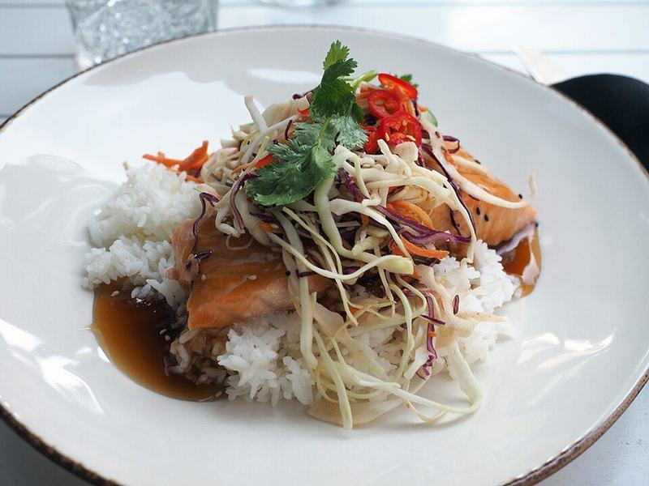

# Teriyaki Salmon Rice Bowls

Photo: JIP · CC BY-SA 4.0 · [source](https://commons.wikimedia.org/wiki/File:Salmon_Teriyaki_at_restaurant_Same_Same_But_Different.jpg)

**Dinner** · Japanese · 25 min · serves 4 · skill 1/3

> Broiled salmon brushed with homemade teriyaki glaze over rice with edamame, cucumber and avocado, finished with sesame and green onion.

| Per serving | kcal | Protein | Carbs | Fat | Fiber | Sodium | Cost |
| --- | --- | --- | --- | --- | --- | --- | --- |
| | 795 | 45 g | 74 g | 36 g | 11 g | 770 mg | $4.29 |

Contains: fish, gluten, sesame

## Ingredients

- 1¼ lb salmon, in 4 pieces
- ¼ cup soy sauce
- 2 tbsp honey
- 1 garlic clove, grated
- 1-inch ginger, grated
- 1½ cups rice
- 12 oz shelled edamame
- 1 cucumber, sliced
- 2 avocados
- green onions
- sesame seeds

From the pantry: 1 tbsp rice vinegar, 1 tsp cornstarch, sriracha mayo (optional)

## Steps

1. Start the rice. Simmer the soy, honey, garlic, ginger, vinegar and ¼ cup water with the cornstarch until thick, 2 minutes. That's your teriyaki.
2. Heat the broiler. Brush the salmon with teriyaki and broil 7 to 9 minutes, brushing twice more, until glazed and just cooked.
3. Cook the edamame and toss the cucumber with a splash of vinegar and salt.
4. Build bowls: rice, salmon, edamame, cucumber and sliced avocado.
5. Drizzle with the remaining teriyaki and top with green onions and sesame seeds.

**Tip:** Line the pan with foil. The glaze burns onto the pan otherwise.

## Storing

Fridge 3 days · freezer not recommended. Store salmon, rice and toppings separately. Salmon is good cold or warmed gently.

## Other ways to make it

- Cod
- Shrimp
- Chicken
