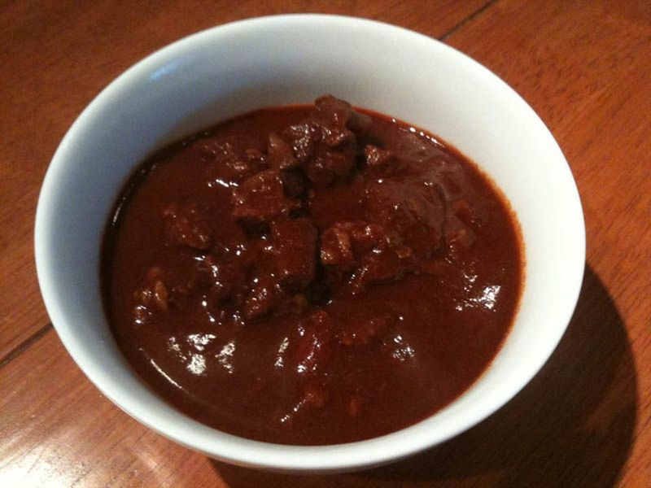

# Texas Red Chili con Carne (No Beans)

Photo: Agentseven at en.wikipedia · Public domain · [source](https://commons.wikimedia.org/wiki/File:Bowl_of_Chili_No_Beans.jpg)

**Dinner** · Tex-Mex · 180 min · serves 6 · skill 2/3

> San Antonio's chili queens style: cubes of chuck slowly simmered in a brick-red purée of toasted ancho chiles, garlic and cumin until spoon-tender. No beans, no tomatoes, all chile.

| Per serving | kcal | Protein | Carbs | Fat | Fiber | Sodium | Cost |
| --- | --- | --- | --- | --- | --- | --- | --- |
| | 730 | 52 g | 22 g | 48 g | 7 g | 490 mg | $4.44 |

Contains: beef, dairy, spicy

## Ingredients

- 3 lb boneless chuck roast, in ½-inch cubes
- 6 oz dried ancho chiles (about 12), stemmed and seeded
- 8 garlic cloves, chopped
- 2 tbsp masa harina
- 1 small onion, diced, to serve
- 1 cup shredded cheddar, to serve
- 2 jalapeños, sliced, to serve

From the pantry: 2 tbsp oil, 1 tbsp ground cumin, 1 tbsp dried oregano, 2 tsp salt, 1 tsp black pepper

## Steps

1. Toast the anchos in a dry skillet over high heat for about 10 seconds per side, until fragrant. Cover with water, bring to a boil, then turn off the heat and let them soak until soft, about 30 minutes.
2. Meanwhile season the beef with salt and pepper and brown it in batches in a large pot with 1 tbsp oil over medium-high, 5 to 6 minutes per batch. Move it to a bowl.
3. Add the remaining oil and the garlic to the pot and stir for 30 seconds. Scrape it into a blender with the drained chiles, cumin, oregano and 2 cups fresh water and blend until completely smooth.
4. Return the beef to the pot, pour in the chile purée plus 4 more cups water and bring to a boil. Lower the heat and simmer uncovered, stirring now and then and adding water if it gets too thick, until the beef is very tender, 2 to 2½ hours.
5. Whisk the masa harina with ¼ cup water, stir it in and simmer 10 minutes more to thicken. Taste for salt and serve in bowls with onion, cheddar and jalapeños.

**Tip:** Taste a soaked ancho first: if it is bitter, rinse the chiles well and discard the soaking water, which carries most of the bitterness. Serve saltines or cornbread on the side if you like.

Adapted from [Homesick Texan](https://www.homesicktexan.com/chili-queens-chili/).

## Storing

Fridge 5 days · freezer up to 4 months. Chili gets better overnight. Reheat over medium-low with a splash of water, stirring, until simmering.

