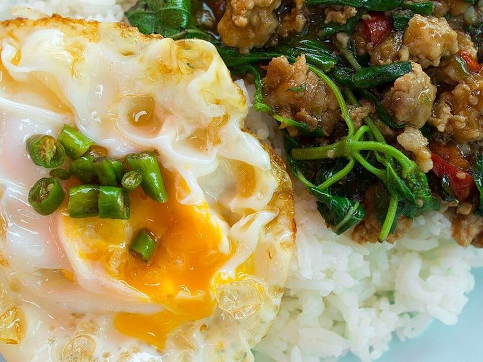

# Thai Basil Chicken (Pad Krapow)

Photo: Takeaway · CC BY-SA 3.0 · [source](https://commons.wikimedia.org/wiki/File:Kraphao_mu_khai_dao.jpg)

**Dinner** · Thai · 15 min · serves 4 · skill 1/3

> Bangkok's favorite fast dinner: minced chicken stir-fried with chilies, garlic and lots of basil, served over rice with a crispy fried egg.

| Per serving | kcal | Protein | Carbs | Fat | Fiber | Sodium | Cost |
| --- | --- | --- | --- | --- | --- | --- | --- |
| | 610 | 46 g | 53 g | 23 g | 1 g | 1450 mg | $3.30 |

Contains: gluten, spicy, egg, fish, shellfish

## Ingredients

- 1½ lb boneless thighs, finely chopped (or ground chicken)
- 8 garlic cloves
- 2 jalapeños or Thai chilies, sliced
- 2 tbsp oyster sauce
- 1 tbsp soy sauce
- 1 tbsp fish sauce
- 2 big handfuls basil
- 4 eggs
- 1½ cups jasmine rice

From the pantry: 3 tbsp oil, 2 tsp sugar

## Steps

1. Start the rice. Pound or finely chop the garlic and chilies together.
2. Fry the eggs in 2 tbsp very hot oil until the edges are crispy. Set aside.
3. Stir-fry the garlic and chilies in the remaining oil for 20 seconds, then add the chicken and cook over high heat until no longer pink, 4 minutes.
4. Add the oyster sauce, soy, fish sauce, sugar and 2 tbsp water and toss until glossy.
5. Turn off the heat and stir in the basil until just wilted. Serve over rice with a fried egg.

**Tip:** Hand-chopping thighs gives a juicier, chunkier texture than ground chicken.

## Storing

Fridge 3 days · freezer up to 2 months. Reheat in a skillet. Fry a fresh egg.

## Other ways to make it

- Steak
- Shrimp
- Pork
- Tofu
