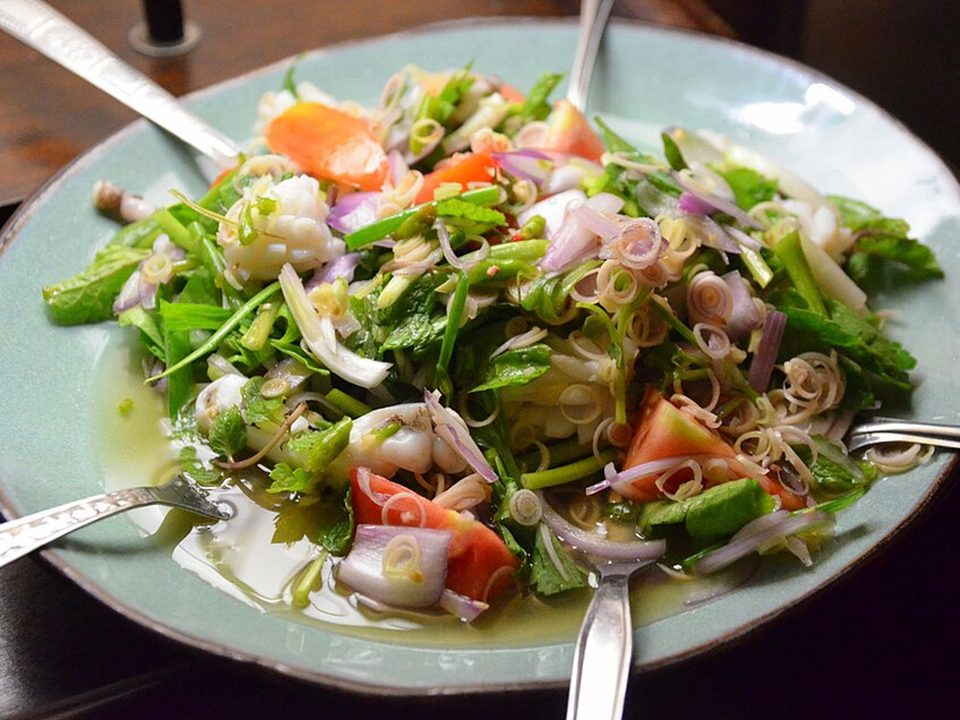

# Crunchy Thai Peanut Chicken Salad

Photo: Takeaway · CC BY-SA 3.0 · [source](https://commons.wikimedia.org/wiki/File:Yam_thale.jpg)

**Lunch** · Thai · 20 min · serves 4 · skill 1/3

> A rainbow of crunchy cabbage, carrots, edamame and chicken tossed in a creamy peanut-lime dressing and finished with roasted peanuts and cilantro. Holds up for days.

| Per serving | kcal | Protein | Carbs | Fat | Fiber | Sodium | Cost |
| --- | --- | --- | --- | --- | --- | --- | --- |
| | 460 | 33 g | 29 g | 26 g | 10 g | 950 mg | $2.00 |

Contains: gluten, nuts

## Ingredients

- 3 cups shredded chicken
- 14 oz coleslaw mix
- 2 carrots, shredded
- 1 cup shelled edamame
- 4 green onions
- cilantro
- ½ cup roasted peanuts
- ⅓ cup peanut butter
- 2 tbsp soy sauce
- 2 limes
- 1 tbsp honey

From the pantry: 1 tbsp rice vinegar, 1 tsp sesame oil, 1 garlic clove, chili flakes

## Steps

1. Whisk the peanut butter, soy, juice of 2 limes, honey, vinegar, sesame oil, grated garlic and 3 tbsp warm water until smooth.
2. Toss the slaw, carrots, edamame, green onions and chicken in a big bowl.
3. Add the dressing and toss well.
4. Fold in the cilantro.
5. Top with peanuts just before serving.

**Tip:** Unlike lettuce salads, this one tastes better on day two.

## Storing

Fridge 4 days · freezer not recommended. Holds up for days. Add peanuts just before eating. Eat cold or at room temperature. No reheating needed.

## Other ways to make it

- Shrimp
- Ground beef
- Black beans (veg)
