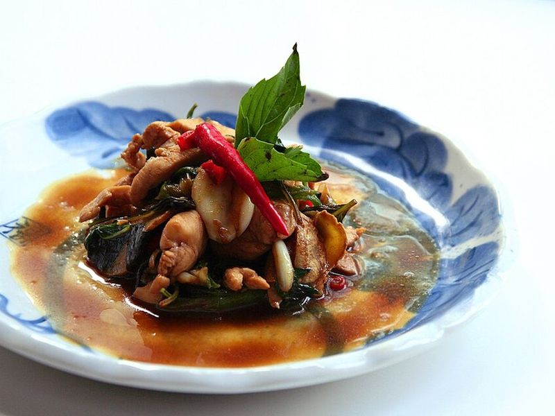

# Three Cup Chicken (San Bei Ji) with Basil

Photo: Archon6812 · CC BY-SA 3.0 · [source](https://commons.wikimedia.org/wiki/File:Sanbeiji.jpg)

**Dinner** · Taiwanese · 35 min · serves 4 · skill 1/3

> A Taiwanese restaurant staple named for its sauce of sesame oil, rice wine and soy. Chicken thighs, whole garlic cloves and thick slices of ginger are braised in it until sticky, then tossed with a huge handful of basil.

| Per serving | kcal | Protein | Carbs | Fat | Fiber | Sodium | Cost |
| --- | --- | --- | --- | --- | --- | --- | --- |
| | 740 | 52 g | 73 g | 24 g | 2 g | 950 mg | $3.19 |

Contains: gluten, sesame

## Ingredients

- 2 lb boneless chicken thighs, in 2-inch pieces
- 15 garlic cloves, peeled
- a 2-inch piece ginger, in thick slices
- ⅓ cup Shaoxing wine
- 3 tbsp soy sauce
- 1 tbsp dark soy sauce
- 1 red chili or jalapeño, sliced
- 1 packed cup basil leaves
- 1½ cups jasmine rice

From the pantry: 3 tbsp toasted sesame oil, 1 tbsp brown sugar, 1 tbsp oil

## Steps

1. Start the rice. Heat the oil and 2 tbsp sesame oil in a wok or wide skillet over medium. Add the ginger and garlic and fry gently until fragrant and just golden at the edges, 2 to 3 minutes. Don't let them brown.
2. Push them to the side, turn the heat to medium-high and add the chicken in one layer. Cook until well browned on one side, 4 to 5 minutes, then turn.
3. Add the Shaoxing wine, soy, dark soy, brown sugar and chili and stir. Cover and simmer over medium, stirring a couple of times, until the chicken is tender and 175°F inside, 10 to 12 minutes.
4. Uncover, turn up the heat and cook, stirring, until the sauce reduces to a thick glaze that clings to the chicken, 3 to 5 minutes.
5. Turn off the heat, toss in the basil and the last 1 tbsp sesame oil until the leaves wilt, and serve over rice.

**Tip:** Thai basil, with its anise flavor, is the traditional choice. Use it if you can find it, and use sweet Italian basil if you can't.

Adapted from [No Recipes (Marc Matsumoto)](https://norecipes.com/three-cup-chicken-san-bei-ji/).

## Storing

Fridge 3 days · freezer up to 2 months. Reheat covered in a skillet with a splash of water; add fresh basil.

