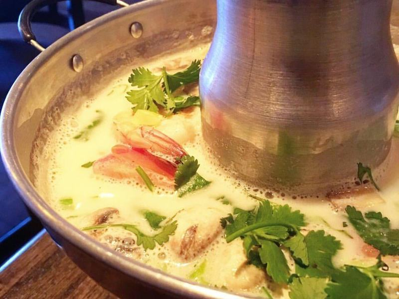

# Tom Kha Gai (Thai Coconut Chicken Soup)

Photo: Julia S. from USA · CC BY 2.0 · [source](https://commons.wikimedia.org/wiki/File:Tom_kha_kai_at_a_restaurant.jpg)

**Lunch** · Thai · 35 min · serves 6 · skill 1/3

> A creamy coconut broth that's sour, salty and fragrant with lemongrass, ginger and lime, full of tender chicken and mushrooms. Rich but bright, it's an easy soup to crave.

| Per serving | kcal | Protein | Carbs | Fat | Fiber | Sodium | Cost |
| --- | --- | --- | --- | --- | --- | --- | --- |
| | 590 | 29 g | 16 g | 48 g | 2 g | 1370 mg | $3.63 |

Contains: fish, spicy

## Ingredients

- 1½ lb boneless chicken thighs, thinly sliced
- 3 cans coconut milk
- 4 cups chicken broth
- 10 oz shiitake mushrooms, sliced
- 2 tbsp lemongrass paste
- 3-inch piece ginger (or galangal), thinly sliced
- 3 tbsp fish sauce
- 3 limes, juiced
- 1 jalapeño or 2 Thai chiles, sliced
- ½ bunch cilantro, chopped
- ½ small onion, sliced

From the pantry: 1 tbsp sugar, ½ tsp salt

## Steps

1. Bring the broth, lemongrass, ginger and onion to a simmer in a large pot over medium heat and cook 5 minutes to flavor it.
2. Add the coconut milk and bring back to a gentle simmer. Don't let it boil hard, or the coconut milk can split.
3. Add the chicken and mushrooms and simmer gently until the chicken is cooked through (165°F), 8 to 10 minutes.
4. Turn off the heat and stir in the fish sauce, lime juice, sugar and chiles. Taste. It should be tangy, salty and a little sweet, so adjust with more lime or fish sauce.
5. Ladle into bowls and top with cilantro. Tell everyone to eat around the ginger slices.

**Tip:** Season it off the heat and taste as you go. Lime juice turns bitter if boiled, and each brand of fish sauce is a different saltiness.

## Storing

Fridge 4 days · freezer not recommended. Coconut milk can turn grainy when frozen. Reheat gently over medium-low until steaming, then add a squeeze of fresh lime.

## Other ways to make it

- Steak
- Shrimp
- Pork
- Tofu
