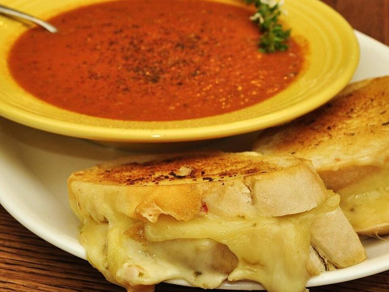

# Creamy Tomato Basil Soup & Grilled Cheese

Photo: jeffreyw · CC BY 2.0 · [source](https://commons.wikimedia.org/wiki/File:Grilled_cheese_sandwich_with_roasted_tomato_soup.jpg)

**Dinner** · American comfort · 35 min · serves 4 · skill 1/3

> Velvety roasted-garlic tomato soup with a splash of cream, and golden, gooey sharp-cheddar grilled cheese for dunking.

| Per serving | kcal | Protein | Carbs | Fat | Fiber | Sodium | Cost |
| --- | --- | --- | --- | --- | --- | --- | --- |
| | 825 | 31 g | 73 g | 48 g | 10 g | 2260 mg | $2.91 |

Contains: dairy, gluten

## Ingredients

- 2 cans (28 oz) crushed tomatoes
- 1 onion, diced
- 4 garlic cloves
- 2 cups broth
- ½ cup heavy cream
- fresh basil
- 8 slices sourdough
- 2 cups shredded sharp cheddar
- 4 tbsp butter

From the pantry: 2 tbsp olive oil, 1 tsp sugar, salt, pepper

## Steps

1. Cook the onion in the oil until soft, 6 minutes. Add the garlic for 1 minute.
2. Add the tomatoes, broth and sugar and simmer 15 minutes.
3. Add a handful of basil and blend until smooth. Stir in the cream and season.
4. Butter the outsides of the bread, fill with cheddar and cook in a skillet over medium-low until deep golden and melted, 3 to 4 minutes per side.
5. Cut the sandwiches into strips and serve with the soup, topped with basil and a swirl of cream.

**Tip:** Low and slow is the key to grilled cheese. High heat burns the bread before the cheese melts.

## Storing

Fridge 5 days · freezer up to 3 months. Freeze the soup without the cream, then stir it in when reheating. Make grilled cheese fresh.

