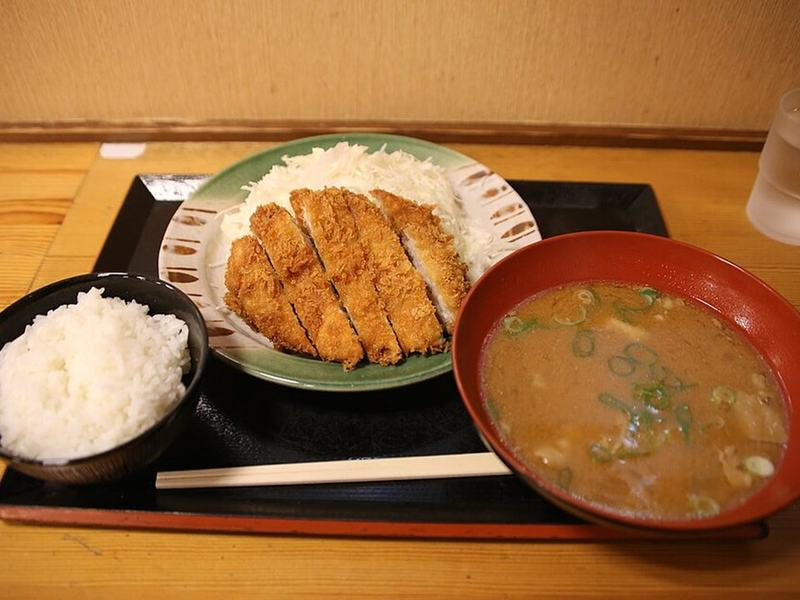

# Crispy Pork Tonkatsu with Shredded Cabbage

Photo: 円周率３パーセント · CC BY-SA 4.0 · [source](https://commons.wikimedia.org/wiki/File:AIchi_Toyohashi_Katsusato_c20250519a.jpg)

**Dinner** · Japanese · 40 min · serves 4 · skill 2/3

> Panko-crusted pork cutlets fried until shatteringly crisp, sliced and served with a mound of cold shredded cabbage, rice and a sweet-tangy homemade katsu sauce.

| Per serving | kcal | Protein | Carbs | Fat | Fiber | Sodium | Cost |
| --- | --- | --- | --- | --- | --- | --- | --- |
| | 895 | 49 g | 93 g | 37 g | 4 g | 820 mg | $2.49 |

Contains: gluten, egg

## Ingredients

- 1½ lb pork tenderloin, cut into 8 medallions
- 2 eggs
- 2 cups panko
- ¼ head green cabbage, very finely shredded
- 2 tsp soy sauce
- 1 lemon, in wedges
- 1½ cups rice (short-grain if you have it)

From the pantry: ½ cup flour for dredging, 1 cup oil for frying, ¼ cup ketchup, 2 tbsp Worcestershire sauce, 1 tbsp sugar, salt, pepper

## Steps

1. Start the rice. Shred the cabbage as thin as you can and keep it in a bowl of ice water. Stir the ketchup, Worcestershire, soy sauce and sugar together for the katsu sauce.
2. Set each medallion between plastic wrap and pound to an even ½ inch. Season with salt and pepper. Set up three shallow dishes: flour, beaten eggs, panko.
3. Dredge each cutlet in flour, dip it in egg, then press it firmly into the panko on both sides. Let them rest 5 minutes so the coating sets.
4. Heat ½ inch of oil in a heavy skillet to 340°F, or until a panko crumb sizzles right away. Fry 3 or 4 cutlets at a time until deep golden, 2 to 3 minutes per side, and 145°F inside. Drain on a rack, not paper towels, and salt lightly.
5. Drain the cabbage well. Rest the pork 2 minutes, slice it into strips and serve with the cabbage, rice, lemon wedges and katsu sauce.

**Tip:** Drain the cutlets on a wire rack. If they sit on paper towels the bottom steams and loses its crunch.

## Storing

Fridge 3 days · freezer up to 1 months. Re-crisp on a rack in a 400°F oven or air fryer for 6 to 8 minutes. Never microwave.

## Other ways to make it

- Chicken
- Steak
- Shrimp
- Tofu
