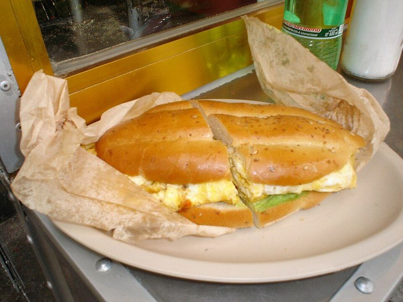

# Chicken Milanesa Tortas with Chipotle Mayo

Photo: Unknown · CC BY 2.5 · [source](https://commons.wikimedia.org/wiki/File:TORTA_DE_HUEVO.jpg)

**Lunch** · Mexican · 40 min · serves 4 · skill 2/3

> A Mexico City lunch counter favorite: thin, crunchy breaded chicken cutlets on toasted rolls with chipotle mayo, avocado, pico de gallo and crisp lettuce.

| Per serving | kcal | Protein | Carbs | Fat | Fiber | Sodium | Cost |
| --- | --- | --- | --- | --- | --- | --- | --- |
| | 795 | 54 g | 67 g | 35 g | 7 g | 990 mg | $2.72 |

Contains: gluten, egg, spicy

## Ingredients

- 1½ lb chicken breasts (2 large), halved horizontally and pounded thin
- 2 eggs
- 1 cup breadcrumbs or panko
- 4 bolillo, telera or soft sandwich rolls
- 1 chipotle in adobo
- 1 ripe avocado, sliced
- 1 Roma tomato, diced
- ¼ onion, diced
- ½ jalapeño, minced
- ½ bunch cilantro
- 1 lime
- a few romaine leaves, shredded

From the pantry: ½ cup flour for coating, 3 tbsp mayo, 3 tbsp oil, 1 tsp salt, ½ tsp black pepper, ½ tsp garlic powder

## Steps

1. Season the cutlets with the salt, pepper and garlic powder. Set up flour, beaten eggs and breadcrumbs in three shallow dishes and coat each cutlet in that order, pressing the crumbs on well.
2. Heat 2 tbsp oil in a large skillet over medium-high. Fry two cutlets at a time until deep golden and cooked through, 3 to 4 minutes per side, adding the last 1 tbsp oil for the second batch. Drain on a rack.
3. Mash the chipotle into the mayo with a squeeze of lime. Stir the tomato, onion, jalapeño and half the cilantro with the rest of the lime juice and a pinch of salt for a quick pico.
4. Split and toast the rolls in the hot pan or under the broiler. Spread with chipotle mayo, then layer lettuce, a cutlet, avocado, pico and cilantro. Press closed and serve.

**Tip:** Cutlets can also be baked: spray them with oil and bake on a rack at 400°F for 15 to 18 minutes. Add a slice of Oaxaca or Monterey Jack cheese if you like.

Adapted from [Mexican Please](https://www.mexicanplease.com/milanesa-torta-baked-chicken-cutlet-sandwich-avocado-pico-de-gallo-chipotle-mayo/).

## Storing

Fridge 2 days · freezer up to 2 months. Freeze breaded cooked cutlets; re-crisp at 400°F for 10 minutes and build tortas fresh.

