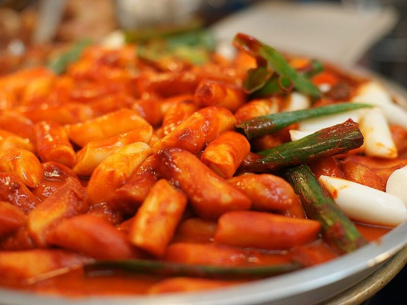

# Tteokbokki (Spicy Korean Rice Cakes) with Boiled Eggs

Photo: Popo le Chien · CC0 · [source](https://commons.wikimedia.org/wiki/File:Tteokbokki.JPG)

**Lunch** · Korean · 40 min · serves 4 · skill 1/3

> Korea's number-one street snack, made a lunch: chewy rice cakes simmered in a glossy, sweet-hot gochujang sauce with cabbage, scallions and halved boiled eggs. Sticky, spicy and very satisfying.

| Per serving | kcal | Protein | Carbs | Fat | Fiber | Sodium | Cost |
| --- | --- | --- | --- | --- | --- | --- | --- |
| | 560 | 16 g | 111 g | 6 g | 4 g | 1130 mg | $2.08 |

Contains: gluten, egg, spicy, fish

## Ingredients

- 1½ lb cylinder rice cakes (tteok)
- ¼ cup gochujang
- 4 eggs, hard-boiled and peeled
- ¼ head green cabbage, in 2-inch pieces
- 4 green onions, in 2-inch pieces
- ½ small onion, sliced
- 3 garlic cloves, minced
- 1 tbsp soy sauce
- 1 tbsp fish sauce

From the pantry: 2 tsp gochugaru, 2½ tbsp sugar, 3½ cups water

## Steps

1. If the rice cakes are refrigerated or frozen, soak them in warm water for 15 to 20 minutes so they cook evenly, then drain.
2. In a large, wide skillet, whisk the water with the gochujang, gochugaru, sugar, soy and fish sauce. Add the onion and bring to a boil over medium-high.
3. Add the rice cakes and boil, stirring often so they don't stick, until soft and chewy and the sauce starts to thicken, 8 to 10 minutes.
4. Add the cabbage, garlic and eggs and keep simmering, stirring and spooning sauce over the eggs, until the cabbage is tender and the sauce is thick and glossy, 4 to 6 minutes. Add a splash of water if it gets too thick before the rice cakes are soft.
5. Stir in the green onions for the last minute, then serve hot.

**Tip:** Korean fish cakes (eomuk) are the classic addition. Cut 2 sheets into strips and add them with the cabbage, and use anchovy-kelp stock in place of water for a deeper sauce.

Adapted from [Korean Bapsang](https://www.koreanbapsang.com/tteokbokki-spicy-stir-fried-rice-cakes/).

## Storing

Fridge 2 days · freezer not recommended. Rice cakes harden in the fridge. Reheat in a skillet with a splash of water, covered, until soft again.

