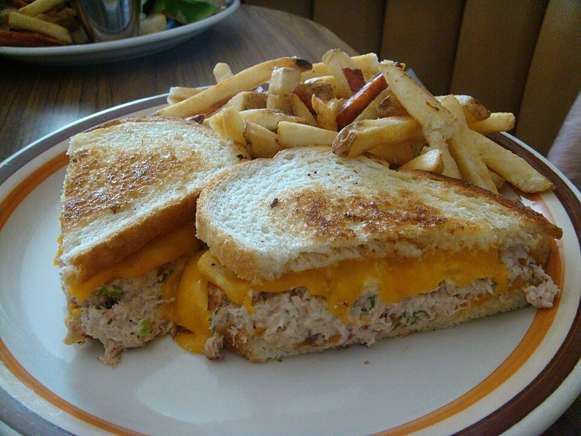

# Diner-Style Tuna Melts

Photo: kweez mcG from London, UK · CC BY 2.0 · [source](https://commons.wikimedia.org/wiki/File:Tuna_melt_sandwich_with_fries.jpg)

**Lunch** · American comfort · 15 min · serves 4 · skill 1/3

> Bright, crunchy tuna salad with celery, pickles and lemon, griddled on sourdough with sharp cheddar until golden and gooey.

| Per serving | kcal | Protein | Carbs | Fat | Fiber | Sodium | Cost |
| --- | --- | --- | --- | --- | --- | --- | --- |
| | 690 | 42 g | 38 g | 40 g | 2 g | 1820 mg | $2.40 |

Contains: fish, dairy, gluten, egg

## Ingredients

- 3 cans albacore tuna, drained
- 2 celery stalks, finely diced
- ¼ cup chopped dill pickles
- ½ lemon
- 8 slices sourdough
- 8 slices sharp cheddar
- butter

From the pantry: ⅓ cup mayo, 1 tsp Dijon, salt, pepper

## Steps

1. Mix the tuna, celery, pickles, mayo, Dijon, lemon juice and pepper.
2. Butter one side of each bread slice.
3. Build sandwiches with the buttered sides out: cheese, tuna salad, cheese.
4. Cook in a skillet over medium-low until deep golden and melted, 3 to 4 minutes per side. Cover the pan for the first side to help the cheese melt.
5. Slice on the diagonal and serve with pickles.

**Tip:** Cheese on both sides of the tuna glues the sandwich together.

## Storing

Fridge 3 days · freezer not recommended. Tuna salad keeps 3 days. Grill sandwiches fresh.

