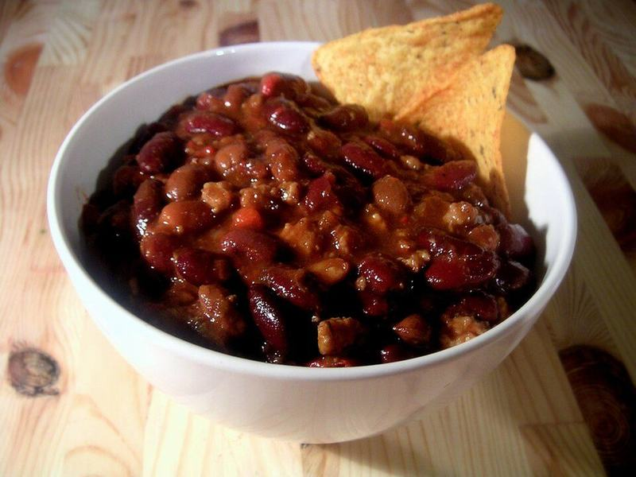

# Weeknight Turkey & Bean Chili

Photo: Carstor · CC BY-SA 2.5 · [source](https://commons.wikimedia.org/wiki/File:Bowl_of_chili.jpg)

**Dinner** · American comfort · 40 min · serves 6 · skill 1/3

> A hearty, smoky pot of lean turkey, two kinds of beans and tomatoes, piled with cheese and sour cream. Freezes like a dream.

| Per serving | kcal | Protein | Carbs | Fat | Fiber | Sodium | Cost |
| --- | --- | --- | --- | --- | --- | --- | --- |
| | 390 | 27 g | 35 g | 17 g | 10 g | 1700 mg | $1.82 |

Contains: dairy

## Ingredients

- 1 lb ground turkey
- 1 onion, diced
- 1 bell pepper, diced
- 1 packet taco or chili seasoning
- 2 cans diced tomatoes
- 1 can kidney beans, drained
- 1 can black beans, drained
- 2 cups chicken broth
- shredded cheese, to serve
- sour cream, to serve

From the pantry: 1 tbsp oil, salt

## Steps

1. Brown the turkey in the oil in a large pot over medium-high, breaking it up, 6 minutes.
2. Add the onion and pepper and cook until soft, 5 minutes.
3. Stir in the seasoning for 30 seconds, then add the tomatoes, beans and broth.
4. Simmer uncovered 20 minutes, stirring now and then, until thick. Season with salt.
5. Serve topped with cheese and sour cream.

**Tip:** A spoon of honey or a square of dark chocolate stirred in at the end rounds out the flavor.

## Storing

Fridge 5 days · freezer up to 4 months. Store toppings separately. Reheat on the stove over medium until simmering, or microwave 2 to 3 minutes, stirring once.

## Other ways to make it

- Ground beef
- Ground pork
- Italian sausage
- Lentils (veg)
