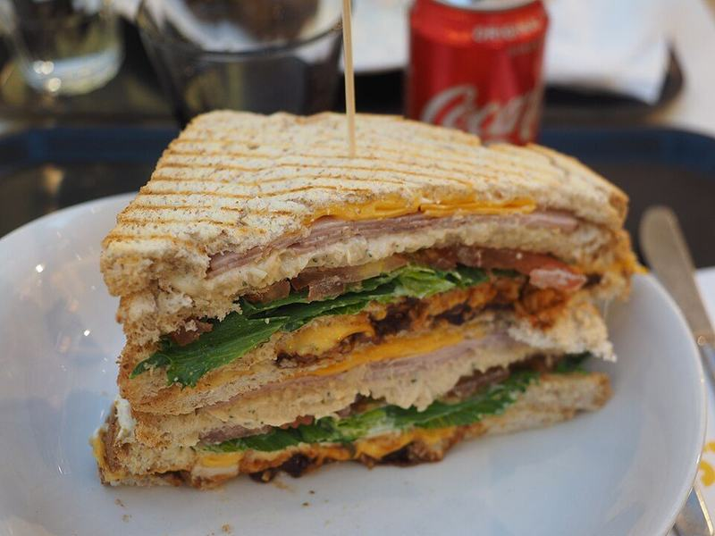

# Triple-Decker Turkey Club with Turkey Bacon

Photo: JIP · CC BY-SA 4.0 · [source](https://commons.wikimedia.org/wiki/File:Club_sandwich_at_Caf%C3%A9_Picnic.jpg)

**Lunch** · American comfort · 25 min · serves 4 · skill 1/3

> A tall, toothpick-pinned diner club stacked with roast turkey, crisp turkey bacon, Swiss, juicy tomato and cold lettuce between three slices of toast.

| Per serving | kcal | Protein | Carbs | Fat | Fiber | Sodium | Cost |
| --- | --- | --- | --- | --- | --- | --- | --- |
| | 600 | 38 g | 43 g | 31 g | 7 g | 2060 mg | $2.40 |

Contains: gluten, dairy, egg

## Ingredients

- 12 slices sandwich bread
- 12 oz sliced turkey breast
- 8 slices turkey bacon
- 4 slices Swiss cheese
- 2 Roma tomatoes, sliced
- 1 romaine heart, leaves separated

From the pantry: ⅓ cup mayo, 1 tsp Dijon mustard, salt, pepper

## Steps

1. Lay the turkey bacon on a foil-lined sheet pan and bake at 400°F until browned and crisp at the edges, 12 to 15 minutes. Drain on paper towels and cut each slice in half.
2. While the bacon bakes, stir the mayo with the Dijon and a few grinds of pepper. Salt the tomato slices lightly and let them sit on a paper towel.
3. Toast all 12 slices of bread until golden, then spread one side of each with the mustard mayo.
4. For each sandwich, layer toast, lettuce, turkey and Swiss, then a second slice of toast, then tomato, bacon and more lettuce, and finish with the last slice, mayo side down.
5. Press gently, pin each corner with a toothpick and cut corner to corner into 4 triangles.

**Tip:** For packed lunches, keep the tomato in a separate container and add it at lunchtime so the toast stays crisp.

## Storing

Fridge 1 days · freezer not recommended. Best the day it's made. Wrap tightly and refrigerate; eat cold.

