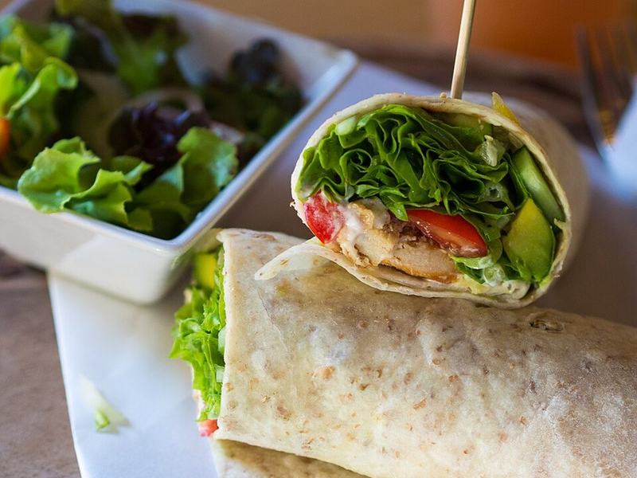

# Turkey Hummus Pinwheel Wraps

Photo: Takeaway · CC BY-SA 3.0 · [source](https://commons.wikimedia.org/wiki/File:Smoked_chicken_and_avocado_wrap.jpg)

**Lunch** · Greek & Mediterranean · 10 min · serves 4 · skill 1/3

> Tortillas spread with hummus and rolled around turkey, spinach and crunchy vegetables, then sliced into lunchbox pinwheels.

| Per serving | kcal | Protein | Carbs | Fat | Fiber | Sodium | Cost |
| --- | --- | --- | --- | --- | --- | --- | --- |
| | 285 | 19 g | 36 g | 8 g | 5 g | 1150 mg | $1.78 |

Contains: gluten, sesame

## Ingredients

- 4 large flour tortillas
- 1 cup hummus
- 9 oz sliced turkey breast
- 2 handfuls baby spinach
- 1 bell pepper, cut in thin strips
- ½ cucumber, cut in thin strips

From the pantry: Black pepper

## Steps

1. Spread each tortilla edge to edge with hummus.
2. Layer on spinach and turkey, leaving a 1-inch strip bare at the far edge.
3. Lay the pepper and cucumber strips across the near edge.
4. Roll up tightly, pressing the bare edge to seal.
5. Slice into 1-inch pinwheels, or halve for a wrap.

**Tip:** Wrapped in plastic, the uncut rolls hold for 2 days without going soggy.

## Storing

Fridge 2 days · freezer not recommended. Keep rolls whole, wrapped tightly, and slice just before eating.

