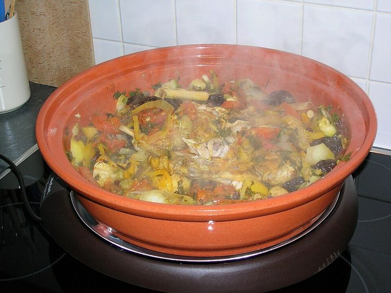

# Turkey Kefta Mkaouara (Meatball & Egg Tagine)

Photo: Everlind · CC BY-SA 3.0 · [source](https://commons.wikimedia.org/wiki/File:ElectricalTajine3.jpg)

**Dinner** · Moroccan · 55 min · serves 4 · skill 2/3

> Little cumin-and-cinnamon spiced turkey meatballs simmered in a thick tomato sauce, finished with eggs poached right in the pan and eaten with crusty bread. Classically beef or lamb.

| Per serving | kcal | Protein | Carbs | Fat | Fiber | Sodium | Cost |
| --- | --- | --- | --- | --- | --- | --- | --- |
| | 705 | 50 g | 60 g | 30 g | 6 g | 1280 mg | $2.91 |

Contains: egg, gluten

## Ingredients

- 1½ lb ground turkey
- 4 eggs
- 2 cans (14.5 oz) diced tomatoes
- 2 onions (½ grated, 1½ sliced)
- 5 garlic cloves, grated
- ½ bunch parsley, minced
- ½ bunch cilantro, minced
- 1 crusty baguette

From the pantry: 3 tbsp olive oil, 1 tbsp paprika, 1 tbsp ground cumin, 1 tsp cinnamon, ½ tsp cayenne, salt, pepper

## Steps

1. Mix the turkey with the grated onion, 2 cloves garlic, half the herbs, 1 tsp each paprika and cumin, ½ tsp cinnamon, a pinch of cayenne, 1 tsp salt and pepper. Roll into 1-inch balls with wet hands.
2. Heat the oil in a large deep skillet with a lid over medium. Cook the sliced onion until soft, 5 minutes, then add the meatballs and brown them on a few sides, 5 minutes.
3. Add the remaining garlic and spices, then the tomatoes and ½ cup water. Cover and simmer gently 25 minutes, stirring once, until the sauce is thick.
4. Make 4 wells and crack in the eggs. Season, cover and cook over low until the whites are set but the yolks are runny, 6 to 8 minutes.
5. Scatter with the remaining herbs and serve from the pan with torn bread.

**Tip:** Turkey is lean, so a tablespoon of olive oil mixed into the meat keeps the kefta tender. Serve it in a clay tagine on a diffuser if you have one.

Adapted from [Tara's Multicultural Table](https://tarasmulticulturaltable.com/kefta-mkaouara-moroccan-meatball-and-egg-tagine/).

## Storing

Fridge 3 days · freezer up to 3 months. Store sauce and meatballs without eggs if you can. Reheat covered over medium-low and poach fresh eggs in it.

