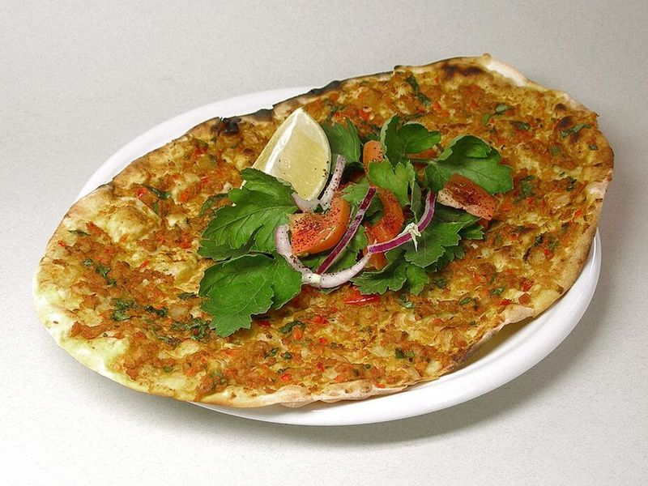

# Turkey Lahmacun (Thin Spiced-Meat Flatbreads) with Parsley-Onion Salad

Photo: No machine-readable author provided. Rainer Zenz assumed (based on copyright claims). · CC BY-SA 3.0 · [source](https://commons.wikimedia.org/wiki/File:Lahmacun.jpg)

**Lunch** · Turkish · 50 min · serves 4 · skill 2/3

> Paper-thin flatbreads baked under a smear of ground turkey blitzed with onion, pepper, tomato, garlic and cumin, then rolled up around parsley, sliced onion and lemon. Classically lamb or beef; turkey keeps it light.

| Per serving | kcal | Protein | Carbs | Fat | Fiber | Sodium | Cost |
| --- | --- | --- | --- | --- | --- | --- | --- |
| | 740 | 38 g | 108 g | 18 g | 8 g | 1230 mg | $3.03 |

Contains: gluten, spicy

## Ingredients

- 1½ lb pizza dough
- 1 lb ground turkey
- 2 yellow onions (1 for topping, 1 for salad)
- 1 red bell pepper
- 2 Roma tomatoes
- 4 garlic cloves
- 1 bunch parsley
- 1 jalapeño (optional)
- 2 lemons, in wedges
- 1 tsp sumac

From the pantry: 2 tbsp tomato paste, 1 tbsp olive oil, 1 tbsp cumin, 2 tsp paprika, 1 tsp red pepper flakes, 1 tbsp flour, salt, pepper

## Steps

1. Heat the oven to 500°F with a heavy baking sheet or pizza stone inside. In a food processor, pulse 1 onion, the bell pepper, tomatoes, garlic, jalapeño and half the parsley to a coarse paste.
2. Mix the paste into the turkey with the tomato paste, oil, cumin, paprika, pepper flakes, 1½ tsp salt and some black pepper. It should be soft and spreadable.
3. Divide the dough into 6 pieces and roll each on a floured counter as thin as you can, about 9 inches across.
4. Spread a thin layer of topping right to the edges of each round. Slide 1 or 2 onto the hot sheet and bake until the edges are crisp and the meat is cooked through, 6 to 8 minutes.
5. Slice the second onion thinly and toss it with the rest of the parsley leaves, the sumac and a pinch of salt. Pile some on each lahmacun, squeeze over lemon, roll up and eat.

**Tip:** Spread the meat thin and raw; it cooks in minutes and the juices soak into the bread. Turkish red pepper paste (biber salçası) in place of half the tomato paste gives the authentic deep, smoky flavor.

Adapted from [Delicious Israel (Chef Sevim Zakuto)](https://deliciousisrael.com/blog/lachmacun-recipe).

## Storing

Fridge 3 days · freezer up to 2 months. Stack with parchment between and freeze. Reheat in a hot skillet, covered, for 2 to 3 minutes a side.

