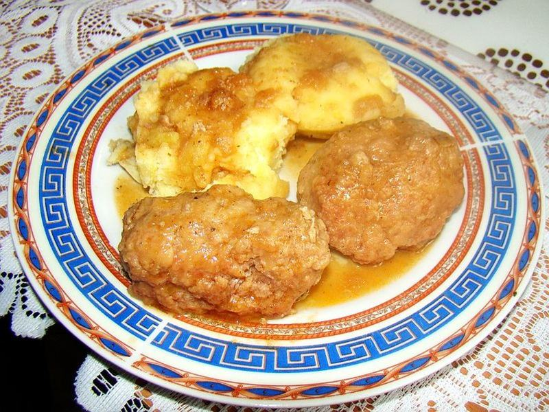

# Greek Turkey Meatballs with Lemon Orzo

Photo: Silar · CC BY-SA 3.0 · [source](https://commons.wikimedia.org/wiki/File:04848_Meatballs_Klopsy,_PL_2011.JPG)

**Dinner** · Greek & Mediterranean · 40 min · serves 4 · skill 1/3

> Juicy spinach-and-feta turkey meatballs roasted until golden, over buttery lemon-herb orzo with a cool cucumber-yogurt sauce.

| Per serving | kcal | Protein | Carbs | Fat | Fiber | Sodium | Cost |
| --- | --- | --- | --- | --- | --- | --- | --- |
| | 765 | 42 g | 76 g | 33 g | 5 g | 1520 mg | $3.32 |

Contains: dairy, gluten, egg

## Ingredients

- 1 lb ground turkey
- 2 handfuls spinach, finely chopped
- ½ cup feta crumbles
- ⅓ cup panko
- 1 egg
- 3 garlic cloves
- 1½ cups orzo
- 3 cups chicken broth
- 2 lemons
- 12 oz tzatziki
- parsley or dill

From the pantry: 2 tsp dried oregano, 2 tbsp olive oil, 1 tbsp butter, salt, pepper

## Steps

1. Heat the oven to 425°F. Mix the turkey, spinach, feta, panko, egg, garlic, oregano and 1 tsp salt. Roll into 16 balls.
2. Roast on an oiled sheet pan 15 to 18 minutes until golden and cooked through.
3. Toast the orzo in the butter, then add the broth and simmer, stirring often, until tender and creamy, 10 minutes.
4. Stir the lemon zest, juice of 1 lemon and herbs into the orzo.
5. Serve the meatballs over orzo with tzatziki and lemon wedges.

**Tip:** Wet your hands before rolling. Turkey mixture is sticky.

## Storing

Fridge 4 days · freezer up to 3 months. Freeze meatballs separately from the orzo. Microwave covered, 1½ to 2 minutes, stirring halfway.

## Other ways to make it

- Ground beef
- Ground pork
- Italian sausage
- Lentils (veg)
