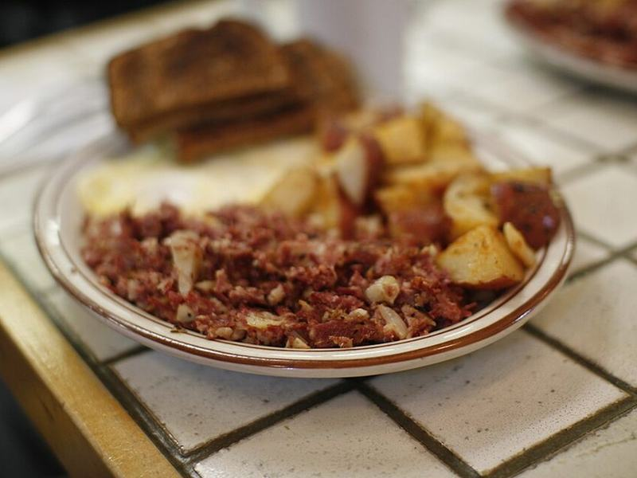

# Turkey Sausage & Sweet Potato Hash with Fried Eggs

Photo: Ginny and John Woods · CC BY-SA 2.0 · [source](https://commons.wikimedia.org/wiki/File:Corned_beef_hash_at_the_Creamery_(Nina%27s_breakfast).jpg)

**Breakfast** · American comfort · 40 min · serves 4 · skill 1/3

> Crispy-edged sweet potato cubes tossed with sage-and-fennel turkey sausage you season yourself, peppers and spinach, topped with runny fried eggs.

| Per serving | kcal | Protein | Carbs | Fat | Fiber | Sodium | Cost |
| --- | --- | --- | --- | --- | --- | --- | --- |
| | 585 | 33 g | 59 g | 25 g | 10 g | 610 mg | $2.48 |

Contains: egg

## Ingredients

- 1 lb ground turkey
- 2 lb sweet potatoes (2 large), in ½-inch cubes
- 1 yellow onion, diced
- 1 bell pepper, diced
- 5 oz baby spinach
- 4 eggs
- 2 green onions, sliced

From the pantry: 3 tbsp olive oil, 1 tbsp maple syrup, 1 tsp dried sage, 1 tsp fennel seed, 1 tsp smoked paprika, ½ tsp red pepper flakes, 1 tsp salt, pepper

## Steps

1. Mix the turkey with the sage, fennel, paprika, pepper flakes, maple syrup, ¾ tsp salt and plenty of pepper. Let it sit while you prep the vegetables.
2. Heat 2 tbsp oil in a large skillet over medium-high. Add the sweet potatoes in an even layer with a pinch of salt, cover, and cook 8 minutes, stirring once, until nearly tender.
3. Uncover, add the onion and pepper and cook until the potatoes are browned at the edges and fork-tender, 6 to 8 minutes more.
4. Push everything to the sides, add the turkey to the center and break it up. Cook until browned and no pink remains, 6 to 7 minutes, then stir it through the hash. Fold in the spinach until just wilted.
5. In a second skillet, fry the eggs in the remaining 1 tbsp oil over medium until the whites are set and the yolks still soft, 3 minutes. Spoon the hash into bowls, top each with an egg and scatter green onions over.

**Tip:** Covering the pan for the first 8 minutes steams the sweet potatoes through, so they brown without burning before the middles are soft.

## Storing

Fridge 4 days · freezer up to 2 months. Store the hash without eggs. Reheat in a skillet over medium until hot and re-crisped, 5 minutes, then fry fresh eggs.

## Other ways to make it

- Ground beef
- Ground pork
- Italian sausage
- Lentils (veg)
