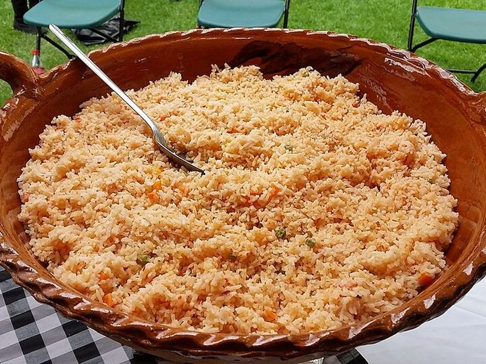

# One-Pan Turkey Taco Rice Skillet

Photo: Ralf Peter Reimann · CC BY-SA 2.0 · [source](https://commons.wikimedia.org/wiki/File:Mexican_rice_144235.jpg)

**Dinner** · Mexican & Tex-Mex · 35 min · serves 4 · skill 1/3

> Seasoned ground turkey, black beans, corn and rice simmered together in one pan, then blanketed with melty cheese. A fast, cheesy weeknight win with very few dishes.

| Per serving | kcal | Protein | Carbs | Fat | Fiber | Sodium | Cost |
| --- | --- | --- | --- | --- | --- | --- | --- |
| | 890 | 47 g | 91 g | 40 g | 17 g | 3240 mg | $3.40 |

Contains: dairy

## Ingredients

- 1 lb ground turkey
- 1 onion, diced
- 1 bell pepper, diced
- 1 packet taco seasoning
- 1 cup long-grain rice, rinsed
- 2¼ cups chicken broth
- 1 can diced tomatoes
- 1 can black beans, drained and rinsed
- 1 cup frozen corn
- 1½ cups shredded Mexican cheese
- green onions, sliced
- 2 avocados, diced, to serve

From the pantry: 1 tbsp oil, ½ tsp salt

## Steps

1. Heat the oil in a large lidded skillet over medium-high. Cook the turkey, onion and bell pepper, breaking up the meat, until browned with no pink left, 6 to 8 minutes.
2. Stir in the taco seasoning and rice and toast for 1 minute.
3. Add the broth, tomatoes with their juice, beans, corn and salt. Bring to a boil, then cover, lower to a gentle simmer and cook until the rice is tender and the liquid absorbed, 18 to 20 minutes.
4. Turn off the heat, scatter the cheese over the top, cover and let it melt, 3 to 4 minutes.
5. Top with green onions and avocado and serve straight from the pan.

**Tip:** Keep the lid on while the rice cooks. Peeking lets out steam and leaves crunchy grains on top.

## Storing

Fridge 4 days · freezer up to 3 months. Microwave covered with a splash of water, 1½ to 2 minutes, stirring halfway.

## Other ways to make it

- Ground beef
- Ground pork
- Italian sausage
- Lentils (veg)
