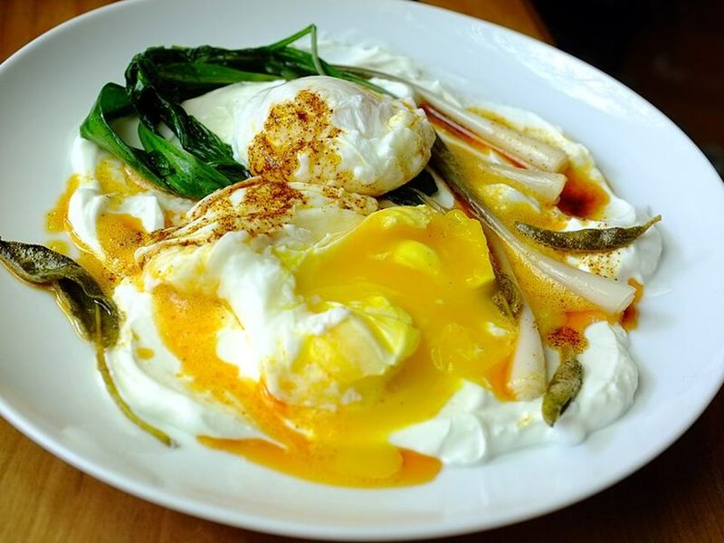

# Turkish Eggs (Çılbır)

Photo: Premshree Pillai from Brooklyn, NY, US · CC BY-SA 2.0 · [source](https://commons.wikimedia.org/wiki/File:%C3%87%C4%B1lb%C4%B1r_with_duck-fat_saut%C3%A9ed_Ramps_(14826584557).jpg)

**Breakfast** · Turkish · 15 min · serves 2 · skill 2/3

> Silky poached eggs over garlicky whipped yogurt, drizzled with sizzling chili-paprika butter. Bring crusty bread for dipping.

| Per serving | kcal | Protein | Carbs | Fat | Fiber | Sodium | Cost |
| --- | --- | --- | --- | --- | --- | --- | --- |
| | 540 | 34 g | 52 g | 22 g | 3 g | 1340 mg | $1.68 |

Contains: egg, dairy, gluten

## Ingredients

- 4 eggs
- 1 cup Greek yogurt, room temperature
- 1 small garlic clove, grated
- 2 tbsp butter
- 1 tsp paprika or Aleppo pepper
- dill or parsley
- 4 slices sourdough, toasted

From the pantry: ½ tsp chili flakes, 1 tbsp vinegar, salt

## Steps

1. Stir the yogurt with the garlic and a pinch of salt and spread onto two plates.
2. Bring a pan of water to a bare simmer with the vinegar.
3. Swirl the water and slide in the eggs one at a time. Poach 3 minutes until the whites are set. Lift out with a slotted spoon.
4. Melt the butter until foaming and stir in the paprika and chili flakes.
5. Set the eggs on the yogurt, spoon over the chili butter and herbs, and serve with toast.

**Tip:** Room-temperature yogurt is the trick. Cold yogurt chills the eggs.

## Storing

Fridge 0 days · freezer not recommended. Best made fresh.

