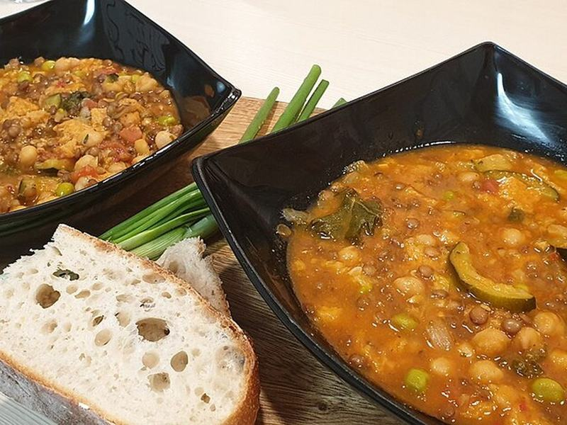

# Tuscan White Bean, Sausage & Kale Soup

Photo: Ta4e Negodue · CC BY-SA 4.0 · [source](https://commons.wikimedia.org/wiki/File:Ribollita_Siena.jpg)

**Dinner** · Italian · 40 min · serves 6 · skill 1/3

> A brothy, garlicky pot of sausage, creamy cannellini beans and tender kale with a Parmesan finish. Even better the next day.

| Per serving | kcal | Protein | Carbs | Fat | Fiber | Sodium | Cost |
| --- | --- | --- | --- | --- | --- | --- | --- |
| | 590 | 30 g | 60 g | 26 g | 10 g | 2410 mg | $2.43 |

Contains: pork, dairy, gluten

## Ingredients

- 1 lb Italian sausage, casings removed
- 1 onion, diced
- 2 carrots, diced
- 5 garlic cloves, sliced
- 1 can diced tomatoes
- 2 cans cannellini beans, drained
- 6 cups chicken broth
- 10 oz chopped kale
- ½ cup grated Parmesan, plus more
- 1 baguette, for serving

From the pantry: 1 tbsp olive oil, red pepper flakes, salt, pepper

## Steps

1. Brown the sausage in the oil in a Dutch oven over medium-high, breaking it into chunks, 6 minutes.
2. Add the onion and carrots and cook until soft, 5 minutes. Add the garlic and a pinch of pepper flakes for 1 minute.
3. Add the tomatoes, beans and broth. Mash a quarter of the beans against the pot to thicken the broth. Simmer 15 minutes.
4. Stir in the kale and simmer until tender, 5 minutes. Stir in the Parmesan and season.
5. Serve with more Parmesan, a drizzle of olive oil and toasted baguette.

**Tip:** Throw in a Parmesan rind while it simmers if you have one.

## Storing

Fridge 5 days · freezer up to 3 months. The kale softens further but tastes great. Reheat on the stove over medium until simmering, or microwave 2 to 3 minutes, stirring once.

## Other ways to make it

- Ground beef
- Ground turkey
- Ground pork
- Lentils (veg)
