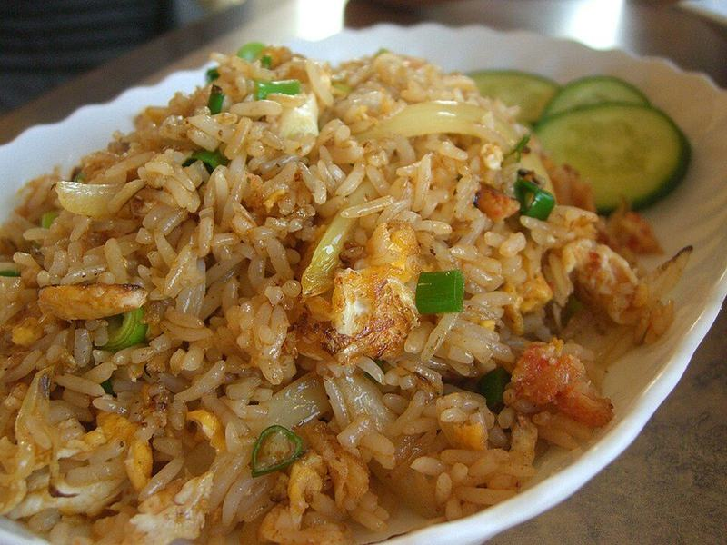

# 15-Minute Veggie Fried Rice

Photo: Alpha from Melbourne, Australia · CC BY-SA 2.0 · [source](https://commons.wikimedia.org/wiki/File:Crab_meat_fried_rice_-_Me_Dee_Thai.jpg)

**Dinner** · Chinese & Cantonese · 20 min · serves 4 · skill 1/3

> Better than takeout and made from what's in the freezer: day-old rice, mixed vegetables, scrambled egg and a hit of soy and sesame.

| Per serving | kcal | Protein | Carbs | Fat | Fiber | Sodium | Cost |
| --- | --- | --- | --- | --- | --- | --- | --- |
| | 445 | 15 g | 64 g | 15 g | 6 g | 790 mg | $0.94 |

Contains: egg, gluten, sesame

## Ingredients

- 1½ cups rice, cooked and chilled (about 4 cups cooked)
- 2 cups frozen mixed vegetables
- 4 eggs
- 3 tbsp soy sauce
- 3 garlic cloves, minced
- 4 green onions, sliced
- sesame seeds

From the pantry: 2 tbsp neutral oil, 1 tsp sesame oil

## Steps

1. Heat 1 tbsp oil in your largest skillet over high heat. Scramble the eggs until just set and move to a plate.
2. Add the remaining oil, the garlic and the whites of the green onions for 30 seconds.
3. Add the frozen vegetables and cook 3 minutes.
4. Add the cold rice, press it into the pan and leave it 1 minute to crisp, then toss. Repeat twice.
5. Add the soy sauce, sesame oil and eggs and toss. Finish with green onion tops and sesame seeds.

**Tip:** Freshly cooked rice turns mushy. Cook it a day ahead, or spread it on a tray and chill for 30 minutes.

## Storing

Fridge 4 days · freezer up to 2 months. Reheat in a skillet over medium with a splash of water until hot, 3 to 5 minutes.

