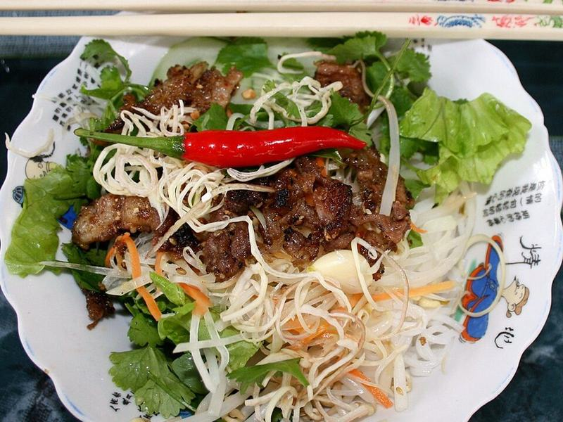

# Lemongrass Pork Vermicelli Bowls (Bún Thịt Nướng)

Photo: Lưu Ly · Public domain · [source](https://commons.wikimedia.org/wiki/File:Bun_thit_nuong.jpg)

**Lunch** · Vietnamese · 35 min · serves 4 · skill 2/3

> Caramelized lemongrass pork over cool rice noodles, crisp lettuce, cucumber, pickled carrots and herbs, all drenched in nuoc cham.

| Per serving | kcal | Protein | Carbs | Fat | Fiber | Sodium | Cost |
| --- | --- | --- | --- | --- | --- | --- | --- |
| | 635 | 39 g | 85 g | 16 g | 6 g | 1120 mg | $3.83 |

Contains: fish, nuts

## Ingredients

- 1¼ lb pork tenderloin or shoulder, thinly sliced
- 2 tbsp lemongrass paste
- ¼ cup fish sauce, divided
- 2 tbsp honey or brown sugar
- 4 garlic cloves
- 8.8 oz rice vermicelli
- 1 romaine heart, shredded
- 1 cucumber, in matchsticks
- 2 carrots, shredded
- mint and cilantro
- 2 limes
- crushed peanuts

From the pantry: Nuoc cham: ½ cup warm water, 3 tbsp sugar, 1 chili. Plus 1 tbsp oil, ¼ cup vinegar

## Steps

1. Marinate the pork with the lemongrass, 2 tbsp fish sauce, honey, half the garlic and the oil for 20 minutes.
2. Quick-pickle the carrots in the vinegar with a pinch of sugar and salt.
3. Make nuoc cham: stir the water, sugar, 2 tbsp fish sauce, juice of 2 limes, remaining garlic and sliced chili.
4. Cook the vermicelli 3 minutes, rinse in cold water and drain well. Grill or sear the pork over high heat until charred, 2 minutes per side.
5. Build bowls: lettuce, noodles, cucumber, pickled carrots, herbs and pork. Top with peanuts and pour over the nuoc cham.

**Tip:** Nuoc cham keeps a week in the fridge. Make a double batch.

## Storing

Fridge 4 days · freezer up to 3 months. Pack pork, noodles, veg and sauce separately. Eat cold or warm the pork.

## Other ways to make it

- Chicken
- Steak
- Shrimp
- Tofu
