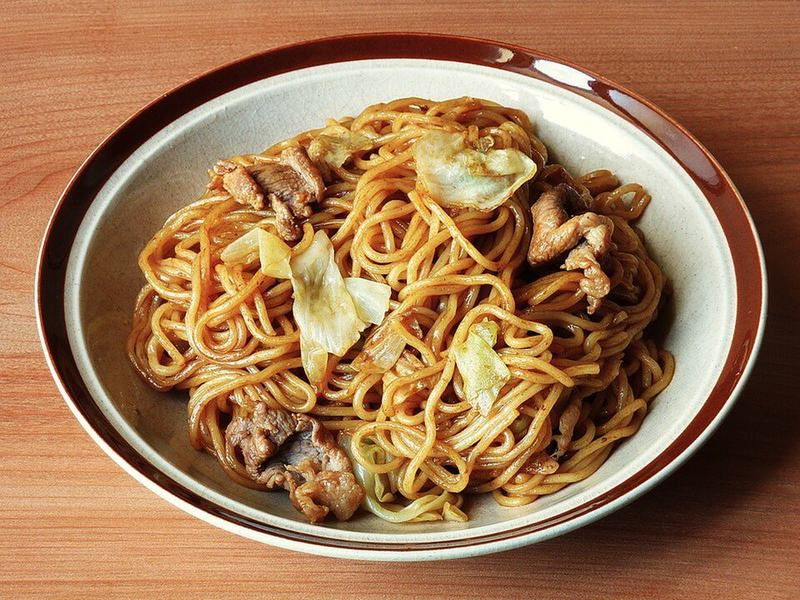

# Chicken Yakisoba

Photo: Quercus acuta · CC BY-SA 4.0 · [source](https://commons.wikimedia.org/wiki/File:Yakisoba_-_01.jpg)

**Dinner** · Japanese · 20 min · serves 4 · skill 1/3

> Japanese street-fair stir-fried noodles with chicken, cabbage and carrots in a tangy-sweet yakisoba sauce.

| Per serving | kcal | Protein | Carbs | Fat | Fiber | Sodium | Cost |
| --- | --- | --- | --- | --- | --- | --- | --- |
| | 570 | 32 g | 82 g | 12 g | 6 g | 1400 mg | $2.08 |

Contains: gluten, shellfish

## Ingredients

- 3 packs yakisoba or chow mein noodles
- 12 oz chicken breast, thinly sliced
- 3 cups shredded cabbage (coleslaw mix)
- 1 onion, sliced
- 1 carrot, in matchsticks
- 2 tbsp soy sauce
- 2 tbsp oyster sauce
- green onions

From the pantry: 2 tbsp Worcestershire, 2 tbsp ketchup, 1 tsp sugar, 2 tbsp oil

## Steps

1. Whisk the Worcestershire, oyster sauce, soy, ketchup and sugar for the sauce.
2. Loosen the noodles by rinsing under hot water. Drain well.
3. Stir-fry the chicken in 1 tbsp oil over high heat until cooked, 4 minutes. Add the onion and carrot for 2 minutes, then the cabbage for 1 minute.
4. Add the remaining oil and the noodles and toss until hot and lightly browned, 2 minutes.
5. Add the sauce and toss until every strand is coated. Top with green onions.

**Tip:** Finish with a squiggle of mayo and a pinch of red pickled ginger for the street-food version.

## Storing

Fridge 3 days · freezer not recommended. Reheat in a skillet with a splash of water, tossing, 3 minutes.

## Other ways to make it

- Steak
- Shrimp
- Pork
- Tofu
