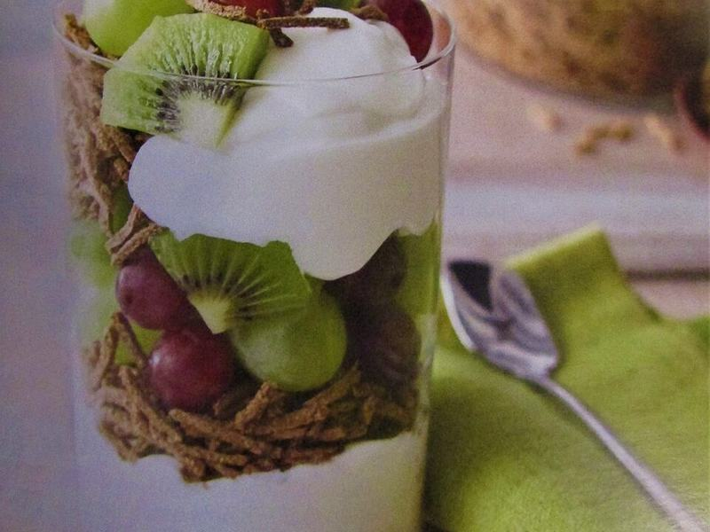

# Honey Berry Yogurt Parfaits

Photo: Kolforn · CC BY-SA 4.0 · [source](https://commons.wikimedia.org/wiki/File:-2020-01-13_Fruit_and_Yogurt_Breakfast_Parfait,_Trimingham.JPG)

**Breakfast** · American comfort · 5 min · serves 4 · skill 1/3

> Thick Greek yogurt layered with crunchy granola and berries, finished with honey. Five minutes and no cooking.

| Per serving | kcal | Protein | Carbs | Fat | Fiber | Sodium | Cost |
| --- | --- | --- | --- | --- | --- | --- | --- |
| | 345 | 22 g | 45 g | 9 g | 5 g | 120 mg | $1.52 |

Contains: dairy, gluten, nuts

## Ingredients

- 3 cups plain Greek yogurt
- 1½ cups granola
- 2 cups berries, thawed (or fresh)
- 2 tbsp honey

From the pantry: ½ tsp vanilla (optional)

## Steps

1. Stir the vanilla and 1 tbsp honey into the yogurt.
2. Spoon a layer of yogurt into 4 glasses or jars.
3. Add a layer of berries and their juice, then granola.
4. Repeat the layers, ending with granola and berries.
5. Drizzle with the rest of the honey and eat right away so the granola stays crunchy.

**Tip:** For make-ahead jars, pack the granola separately and add it in the morning.

## Storing

Fridge 3 days · freezer not recommended. Pack granola separately so it stays crunchy.

